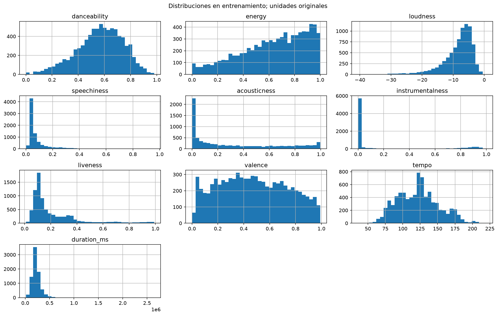
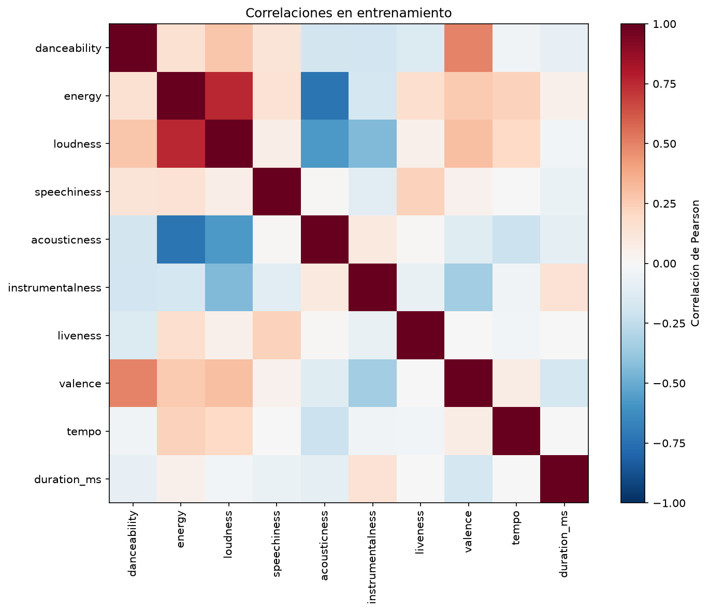
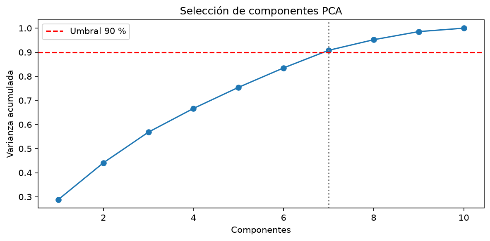
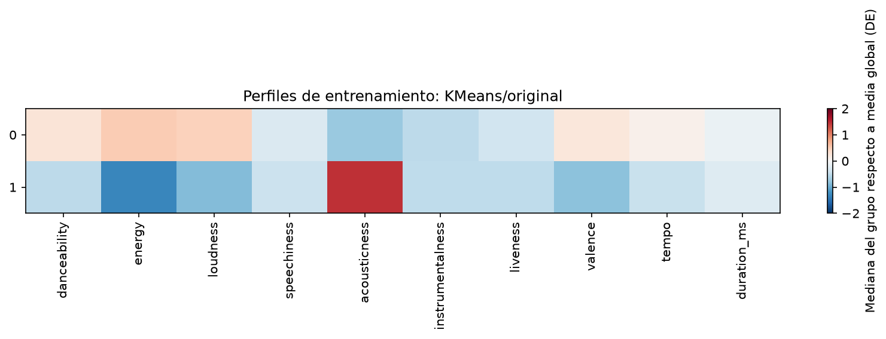
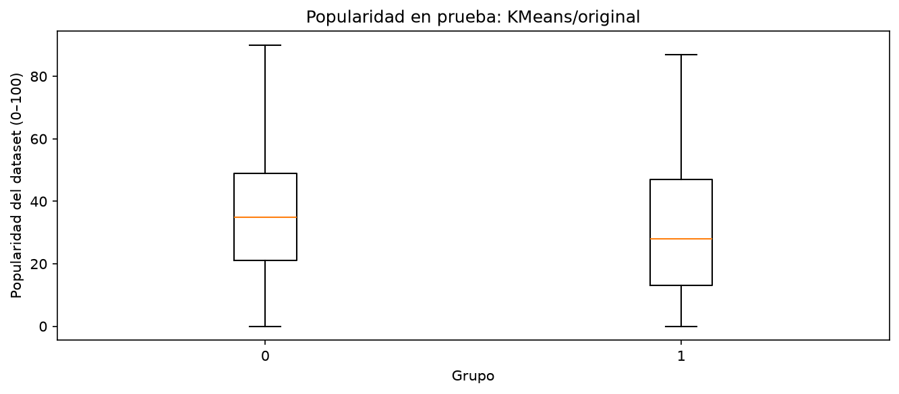
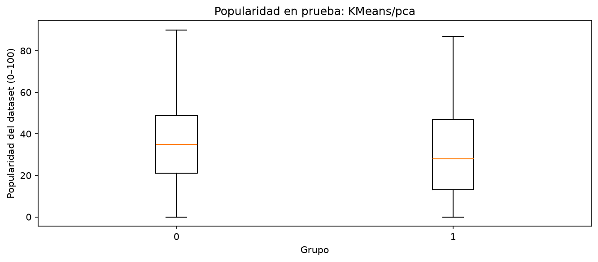
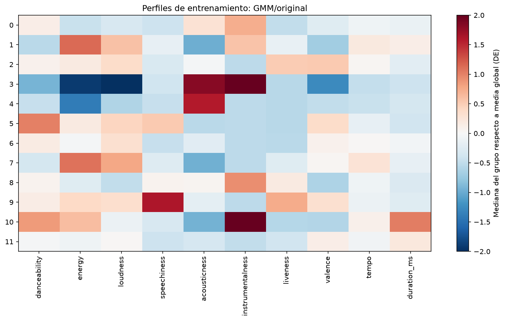
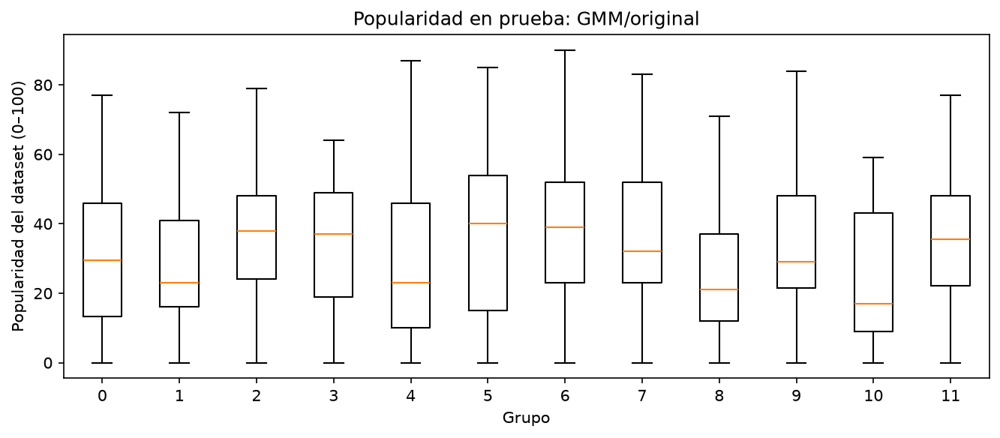
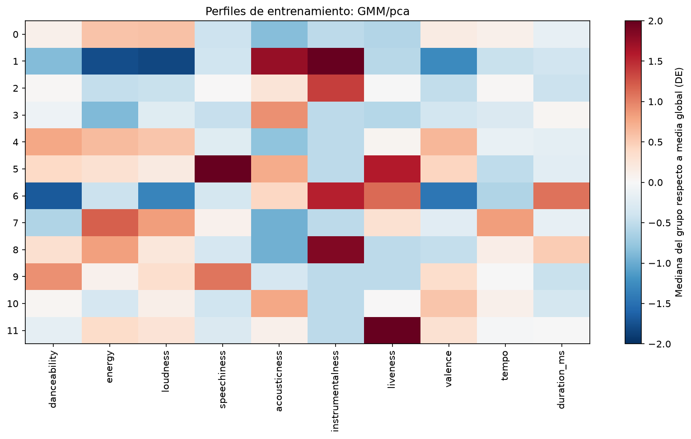
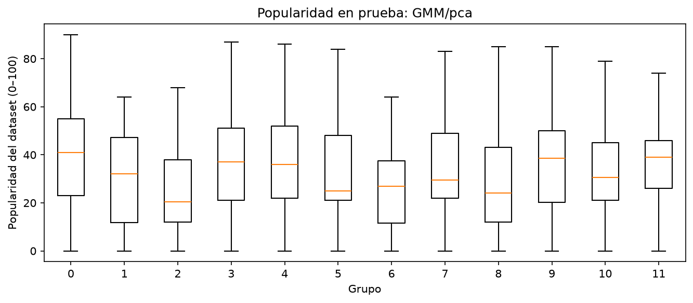

# Perfiles sonoros y popularidad musical

## Comparación de K-Means y GMM antes y después de PCA

## Resumen

Se analizaron 10,000 canciones únicas (8,000 entrenamiento y 2,000 prueba) usando diez características sonoras. PCA retuvo 7 componentes y 90.81% de varianza. La configuración recomendada por Silhouette de entrenamiento en el espacio común es **KMeans/pca**, con 2 grupos y Silhouette 0.2497. La recomendación prioriza compactación y debe contrastarse con estabilidad e interpretación. No se entrenó un predictor de éxitos. En prueba, las medianas de popularidad de la configuración recomendada van de 28.0 (grupo 1) a 35.0 (grupo 0), con epsilon cuadrado 0.0071. Los intervalos intercuartílicos de esos grupos son [13.0, 47.0] y [21.0, 49.0]. Las medianas diferentes no permiten identificar individualmente una canción popular; debe considerarse el solapamiento de distribuciones.

## 1. Problema y justificación

¿Los perfiles descubiertos únicamente por características sonoras presentan distintas distribuciones de popularidad? La utilidad es organizar un catálogo en perfiles acústicos y comprender asociaciones descriptivas. No existen etiquetas verdaderas de perfil sonoro; el género es información contextual y no objetivo de entrenamiento. No se interpretan asociaciones como causas ni se afirma predecir popularidad futura.

## 2. Fuente y preparación

Fuente: Maharshi Pandya, Spotify Tracks Dataset, repositorio público de Hugging Face. La ficha declara BSD; revisar el alcance de esa declaración y los términos originales antes de redistribuir. Se descargan características tabulares, no audio. La fecha exacta de medición de popularidad no se conoce.

Filas fuente: 114,000; utilizables únicas: 89,741; filas con identificador repetido: 40,900. Eliminados por duplicación de ID: 24,259 registros (los valores exactos de cada paso se conservan en auditoria.json). Se conserva la primera aparición en orden de archivo, sin escoger por popularidad. Ver auditoria.json para tipos, faltantes y conflictos entre duplicados.

Se convierten valores imposibles en faltantes; tempo cero se trata como estimación ausente. No se eliminan automáticamente atípicos legítimos. Se imputa por mediana y se aplica StandardScaler ajustando ambos solo con entrenamiento. División 80/20 y semilla 42. Los diez campos son danceability, energy, loudness, speechiness, acousticness, instrumentalness, liveness, valence, tempo, duration_ms. Popularidad, género, identificadores, nombres y artistas quedan fuera del ajuste. Duración conserva milisegundos y loudness decibelios en los perfiles originales.

Los atípicos por regla IQR se documentan en atipicos_train.csv.

| variable | fracción atípicos IQR |
|---|---|
| danceability | 0.007625 |
| energy | 0 |
| loudness | 0.05187 |
| speechiness | 0.122 |
| acousticness | 0 |
| instrumentalness | 0.2184 |
| liveness | 0.07925 |
| valence | 0 |
| tempo | 0.00525 |
| duration_ms | 0.046 |

El escalado no neutraliza su influencia: K-Means es sensible a distancias extremas y GMM a estimaciones de medias y covarianzas.

## 3. Diseño experimental

Se exploran K=2…12. K-Means usa n_init=20 y se selecciona por mayor Silhouette en entrenamiento; el codo se utiliza como diagnóstico. GMM compara covarianzas full/diag, n_init=3, máximo 500 iteraciones y regularización 1e-5; se elige el menor BIC entre ajustes convergidos. Se reajustan hiperparámetros tras PCA. Si criterios discrepan se mantienen estas reglas predefinidas, sin consultar popularidad. Silhouette usa hasta 2.000 filas elegidas con semilla fija; Davies-Bouldin y Calinski-Harabasz usan el conjunto completo.

Silhouette mayor indica mejor cohesión/separación; Davies-Bouldin menor indica menor similitud entre grupos; Calinski-Harabasz mayor refleja separación entre grupos respecto a dispersión interna. Son criterios geométricos, no pruebas de categorías musicales verdaderas.

## 4. PCA

| variable | PC1 | PC2 |
|---|---|---|
| danceability | 0.2731 | 0.435 |
| energy | 0.4977 | -0.2916 |
| loudness | 0.5121 | -0.09364 |
| speechiness | 0.1056 | 0.1414 |
| acousticness | -0.4276 | 0.3594 |
| instrumentalness | -0.29 | -0.3315 |
| liveness | 0.05869 | -0.08664 |
| valence | 0.319 | 0.4618 |
| tempo | 0.1747 | -0.2438 |
| duration_ms | -0.0409 | -0.4216 |

Las cargas son coeficientes de la combinación lineal sobre variables estandarizadas. Su signo puede invertirse sin cambiar el significado de PCA. No equivalen a causalidad.

## 5. Tabla comparativa obligatoria

Las filas PCA evaluadas en original usan las etiquetas de PCA y las distancias del espacio original escalado. Son las filas apropiadas para comparar configuraciones en una geometría común. Ruido es 0 % por construcción: estos modelos asignan todas las canciones; no realizan detección de ruido.

| model | space | evaluation_space | split | hyperparameters | groups | noise_pct | fit_seconds | predict_test_seconds | ari_vs_original | silhouette | davies_bouldin | calinski_harabasz |
|---|---|---|---|---|---|---|---|---|---|---|---|---|
| KMeans | original | original | train | {"k": 2, "covariance": "NA"} | 2 | 0 | 0.04374 | 0.0002806 | nan | 0.2493 | 1.683 | 1948 |
| KMeans | original | original | test | {"k": 2, "covariance": "NA"} | 2 | 0 | 0.04374 | 0.0002806 | nan | 0.246 | 1.679 | 493.5 |
| KMeans | pca | pca | train | {"k": 2, "covariance": "NA"} | 2 | 0 | 0.03854 | 0.0002236 | 0.9825 | 0.2703 | 1.56 | 2195 |
| KMeans | pca | original | train | {"k": 2, "covariance": "NA"} | 2 | 0 | 0.03854 | 0.0002236 | 0.9825 | 0.2497 | 1.678 | 1947 |
| KMeans | pca | pca | test | {"k": 2, "covariance": "NA"} | 2 | 0 | 0.03854 | 0.0002236 | 0.983 | 0.268 | 1.554 | 558.3 |
| KMeans | pca | original | test | {"k": 2, "covariance": "NA"} | 2 | 0 | 0.03854 | 0.0002236 | 0.983 | 0.2477 | 1.673 | 493.7 |
| GMM | original | original | train | {"k": 12, "covariance": "full"} | 12 | 0 | 1.606 | 0.001373 | nan | -0.02085 | 3.409 | 399.3 |
| GMM | original | original | test | {"k": 12, "covariance": "full"} | 12 | 0 | 1.606 | 0.001373 | nan | -0.01186 | 3.347 | 104.7 |
| GMM | pca | pca | train | {"k": 12, "covariance": "full"} | 12 | 0 | 0.8949 | 0.00225 | 0.2905 | 0.02409 | 2.32 | 648.1 |
| GMM | pca | original | train | {"k": 12, "covariance": "full"} | 12 | 0 | 0.8949 | 0.00225 | 0.2905 | 0.0194 | 2.535 | 556 |
| GMM | pca | pca | test | {"k": 12, "covariance": "full"} | 12 | 0 | 0.8949 | 0.00225 | 0.2797 | 0.03053 | 2.463 | 161.8 |
| GMM | pca | original | test | {"k": 12, "covariance": "full"} | 12 | 0 | 0.8949 | 0.00225 | 0.2797 | 0.02431 | 2.684 | 138.2 |

## 6. Estabilidad

Cuatro semillas y cuatro submuestras del 80 % de entrenamiento. Cada ejecución asigna el mismo conjunto de prueba y se calcula ARI entre pares. El preprocesamiento permanece fijo: esta es estabilidad condicional al escalado/PCA, no incertidumbre de todo el pipeline.

| model | space | kind | mean | min | max |
|---|---|---|---|---|---|
| GMM | original | seed | 0.5657 | 0.4389 | 0.7459 |
| GMM | original | subsample | 0.5714 | 0.4628 | 0.6868 |
| GMM | pca | seed | 0.7344 | 0.6357 | 0.976 |
| GMM | pca | subsample | 0.5519 | 0.458 | 0.6742 |
| KMeans | original | seed | 1 | 1 | 1 |
| KMeans | original | subsample | 0.9947 | 0.9915 | 0.9979 |
| KMeans | pca | seed | 0.9979 | 0.9957 | 1 |
| KMeans | pca | subsample | 0.994 | 0.9893 | 0.9957 |

## 7. Perfiles y popularidad

### KMeans/original

| cluster | danceability | energy | loudness | speechiness | acousticness | instrumentalness | liveness | valence | tempo | duration_ms |
|---|---|---|---|---|---|---|---|---|---|---|
| 0 | 0.61 | 0.763 | -6.134 | 0.0547 | 0.0784 | 1.8e-05 | 0.141 | 0.533 | 125 | 2.148e+05 |
| 1 | 0.471 | 0.303 | -12.94 | 0.0393 | 0.817 | 0.00504 | 0.117 | 0.262 | 108.9 | 2.013e+05 |

| split | cluster | n | median | mean | q25 | q75 | fraction_ge_70 |
|---|---|---|---|---|---|---|---|
| test | 0 | 1498 | 35 | 34.12 | 21 | 49 | 0.03872 |
| test | 1 | 502 | 28 | 29.9 | 13 | 47 | 0.01195 |
| train | 0 | 5967 | 34 | 33.76 | 20 | 48 | 0.03704 |
| train | 1 | 2033 | 29 | 30.41 | 17 | 46 | 0.01623 |

Grupo 0: **energía alta, perfil mixto**; mediana tempo 125.0 BPM y duración 3.58 minutos. Puede utilizarse como filtro exploratorio de catálogo; no implica una recomendación personalizada validada.

Grupo 1: **energía baja, perfil acústico**; mediana tempo 108.9 BPM y duración 3.35 minutos. Puede utilizarse como filtro exploratorio de catálogo; no implica una recomendación personalizada validada.

### KMeans/pca

| cluster | danceability | energy | loudness | speechiness | acousticness | instrumentalness | liveness | valence | tempo | duration_ms |
|---|---|---|---|---|---|---|---|---|---|---|
| 0 | 0.61 | 0.762 | -6.142 | 0.0546 | 0.0793 | 1.795e-05 | 0.141 | 0.5325 | 125 | 2.149e+05 |
| 1 | 0.468 | 0.299 | -13.02 | 0.0393 | 0.8185 | 0.00516 | 0.117 | 0.261 | 108.4 | 2.004e+05 |

| split | cluster | n | median | mean | q25 | q75 | fraction_ge_70 |
|---|---|---|---|---|---|---|---|
| test | 0 | 1504 | 35 | 34.12 | 21 | 49 | 0.03856 |
| test | 1 | 496 | 28 | 29.86 | 13 | 47 | 0.0121 |
| train | 0 | 5990 | 34 | 33.79 | 20 | 48 | 0.03706 |
| train | 1 | 2010 | 29 | 30.3 | 17 | 46 | 0.01592 |

Grupo 0: **energía alta, perfil mixto**; mediana tempo 125.0 BPM y duración 3.58 minutos. Puede utilizarse como filtro exploratorio de catálogo; no implica una recomendación personalizada validada.

Grupo 1: **energía baja, perfil acústico**; mediana tempo 108.4 BPM y duración 3.34 minutos. Puede utilizarse como filtro exploratorio de catálogo; no implica una recomendación personalizada validada.

### GMM/original

| cluster | danceability | energy | loudness | speechiness | acousticness | instrumentalness | liveness | valence | tempo | duration_ms |
|---|---|---|---|---|---|---|---|---|---|---|
| 0 | 0.5875 | 0.5205 | -10.1 | 0.0401 | 0.4225 | 0.403 | 0.1195 | 0.413 | 119.7 | 2.147e+05 |
| 1 | 0.469 | 0.924 | -5.515 | 0.0701 | 0.000432 | 0.355 | 0.187 | 0.294 | 128 | 2.416e+05 |
| 2 | 0.5805 | 0.682 | -6.611 | 0.05285 | 0.312 | 0 | 0.312 | 0.611 | 123.3 | 2.061e+05 |
| 3 | 0.4 | 0.145 | -19.05 | 0.0429 | 0.937 | 0.907 | 0.107 | 0.141 | 107.9 | 1.869e+05 |
| 4 | 0.4825 | 0.2785 | -11.56 | 0.0356 | 0.858 | 5.14e-06 | 0.109 | 0.3455 | 109 | 1.92e+05 |
| 5 | 0.743 | 0.682 | -6.282 | 0.149 | 0.144 | 0 | 0.107 | 0.571 | 117.3 | 1.891e+05 |
| 6 | 0.594 | 0.623 | -6.883 | 0.0345 | 0.249 | 1.26e-06 | 0.111 | 0.495 | 123 | 2.226e+05 |
| 7 | 0.5035 | 0.9125 | -4.517 | 0.058 | 0.002095 | 1.59e-05 | 0.169 | 0.4865 | 130 | 2.116e+05 |
| 8 | 0.577 | 0.5745 | -11.04 | 0.09665 | 0.343 | 0.4695 | 0.2485 | 0.3125 | 119.4 | 1.99e+05 |
| 9 | 0.5905 | 0.7375 | -6.771 | 0.2745 | 0.2625 | 0 | 0.357 | 0.5585 | 118.5 | 2.043e+05 |
| 10 | 0.714 | 0.792 | -9.087 | 0.051 | 0.00655 | 0.862 | 0.105 | 0.323 | 125 | 3.308e+05 |
| 11 | 0.5595 | 0.612 | -8.377 | 0.04135 | 0.215 | 0.009975 | 0.1405 | 0.511 | 120.1 | 2.493e+05 |

| split | cluster | n | median | mean | q25 | q75 | fraction_ge_70 |
|---|---|---|---|---|---|---|---|
| test | 0 | 170 | 29.5 | 30.08 | 13.25 | 46 | 0.01176 |
| test | 1 | 174 | 23 | 27.95 | 16 | 41 | 0.01724 |
| test | 2 | 350 | 38 | 36.1 | 24 | 48 | 0.03143 |
| test | 3 | 105 | 37 | 32.2 | 19 | 49 | 0 |
| test | 4 | 102 | 23 | 27.99 | 10 | 46 | 0.009804 |
| test | 5 | 185 | 40 | 35.56 | 15 | 54 | 0.08108 |
| test | 6 | 371 | 39 | 36.61 | 23 | 52 | 0.05121 |
| test | 7 | 194 | 32 | 34.65 | 23 | 52 | 0.02577 |
| test | 8 | 93 | 21 | 26 | 12 | 37 | 0.01075 |
| test | 9 | 111 | 29 | 33.23 | 21.5 | 48 | 0.03604 |
| test | 10 | 71 | 17 | 24.1 | 9 | 43 | 0 |
| test | 11 | 74 | 35.5 | 34.84 | 22.25 | 48 | 0.04054 |
| train | 0 | 640 | 28 | 31.56 | 17.75 | 48 | 0.02656 |
| train | 1 | 695 | 22 | 27.86 | 16 | 40 | 0.01295 |
| train | 2 | 1328 | 37 | 34.96 | 23 | 47 | 0.03464 |
| train | 3 | 405 | 29 | 30.87 | 18 | 47 | 0.007407 |
| train | 4 | 496 | 26 | 28.73 | 12 | 46 | 0.01008 |
| train | 5 | 850 | 38 | 35.08 | 19 | 52 | 0.06706 |
| train | 6 | 1407 | 39 | 37.08 | 24 | 52.5 | 0.04762 |
| train | 7 | 690 | 32.5 | 34.89 | 22 | 51.75 | 0.04203 |
| train | 8 | 414 | 28 | 28.19 | 15 | 41 | 0.007246 |
| train | 9 | 436 | 29 | 32.34 | 21 | 44.25 | 0.02064 |
| train | 10 | 283 | 20 | 24.76 | 9 | 41 | 0 |
| train | 11 | 356 | 30 | 32.92 | 20 | 48.25 | 0.02528 |

Grupo 0: **energía intermedia, perfil mixto**; mediana tempo 119.7 BPM y duración 3.58 minutos. Puede utilizarse como filtro exploratorio de catálogo; no implica una recomendación personalizada validada.

Grupo 1: **energía alta, perfil mixto**; mediana tempo 128.0 BPM y duración 4.03 minutos. Puede utilizarse como filtro exploratorio de catálogo; no implica una recomendación personalizada validada.

Grupo 2: **energía alta, perfil mixto**; mediana tempo 123.3 BPM y duración 3.43 minutos. Puede utilizarse como filtro exploratorio de catálogo; no implica una recomendación personalizada validada.

Grupo 3: **energía baja, perfil acústico**; mediana tempo 107.9 BPM y duración 3.11 minutos. Puede utilizarse como filtro exploratorio de catálogo; no implica una recomendación personalizada validada.

Grupo 4: **energía baja, perfil acústico**; mediana tempo 109.0 BPM y duración 3.20 minutos. Puede utilizarse como filtro exploratorio de catálogo; no implica una recomendación personalizada validada.

Grupo 5: **energía alta, perfil mixto**; mediana tempo 117.3 BPM y duración 3.15 minutos. Puede utilizarse como filtro exploratorio de catálogo; no implica una recomendación personalizada validada.

Grupo 6: **energía intermedia, perfil mixto**; mediana tempo 123.0 BPM y duración 3.71 minutos. Puede utilizarse como filtro exploratorio de catálogo; no implica una recomendación personalizada validada.

Grupo 7: **energía alta, perfil mixto**; mediana tempo 130.0 BPM y duración 3.53 minutos. Puede utilizarse como filtro exploratorio de catálogo; no implica una recomendación personalizada validada.

Grupo 8: **energía intermedia, perfil mixto**; mediana tempo 119.4 BPM y duración 3.32 minutos. Puede utilizarse como filtro exploratorio de catálogo; no implica una recomendación personalizada validada.

Grupo 9: **energía alta, perfil mixto**; mediana tempo 118.5 BPM y duración 3.41 minutos. Puede utilizarse como filtro exploratorio de catálogo; no implica una recomendación personalizada validada.

Grupo 10: **energía alta, perfil instrumental**; mediana tempo 125.0 BPM y duración 5.51 minutos. Puede utilizarse como filtro exploratorio de catálogo; no implica una recomendación personalizada validada.

Grupo 11: **energía intermedia, perfil mixto**; mediana tempo 120.1 BPM y duración 4.15 minutos. Puede utilizarse como filtro exploratorio de catálogo; no implica una recomendación personalizada validada.

### GMM/pca

| cluster | danceability | energy | loudness | speechiness | acousticness | instrumentalness | liveness | valence | tempo | duration_ms |
|---|---|---|---|---|---|---|---|---|---|---|
| 0 | 0.583 | 0.78 | -5.532 | 0.0401 | 0.04185 | 6.815e-06 | 0.101 | 0.5165 | 125 | 2.113e+05 |
| 1 | 0.411 | 0.18 | -17.78 | 0.0424 | 0.909 | 0.898 | 0.108 | 0.141 | 109 | 1.887e+05 |
| 2 | 0.569 | 0.511 | -10.74 | 0.0896 | 0.414 | 0.616 | 0.212 | 0.346 | 123 | 1.854e+05 |
| 3 | 0.5465 | 0.4095 | -9.739 | 0.0345 | 0.632 | 9.33e-06 | 0.105 | 0.3795 | 113.4 | 2.311e+05 |
| 4 | 0.701 | 0.795 | -5.639 | 0.06035 | 0.0552 | 6.765e-06 | 0.224 | 0.6485 | 117.7 | 2.084e+05 |
| 5 | 0.634 | 0.713 | -7.578 | 0.423 | 0.573 | 0 | 0.521 | 0.585 | 106.9 | 2.06e+05 |
| 6 | 0.269 | 0.523 | -15.26 | 0.0472 | 0.465 | 0.673 | 0.434 | 0.0961 | 104.2 | 3.368e+05 |
| 7 | 0.459 | 0.941 | -4.205 | 0.0975 | 0.00286 | 4.18e-05 | 0.273 | 0.417 | 147 | 2.109e+05 |
| 8 | 0.621 | 0.843 | -7.319 | 0.04995 | 0.004295 | 0.7655 | 0.1145 | 0.351 | 126 | 2.792e+05 |
| 9 | 0.725 | 0.657 | -6.776 | 0.212 | 0.211 | 0 | 0.115 | 0.567 | 122 | 1.825e+05 |
| 10 | 0.571 | 0.5485 | -7.896 | 0.0416 | 0.5835 | 1.25e-06 | 0.2175 | 0.6175 | 125 | 1.925e+05 |
| 11 | 0.5325 | 0.7285 | -7.121 | 0.0546 | 0.3595 | 1.75e-06 | 0.6985 | 0.552 | 121.5 | 2.278e+05 |

| split | cluster | n | median | mean | q25 | q75 | fraction_ge_70 |
|---|---|---|---|---|---|---|---|
| test | 0 | 280 | 41 | 37.57 | 23 | 55 | 0.06071 |
| test | 1 | 128 | 32 | 29.96 | 11.75 | 47.25 | 0 |
| test | 2 | 98 | 20.5 | 25.39 | 12 | 38 | 0 |
| test | 3 | 321 | 37 | 34.48 | 21 | 51 | 0.02492 |
| test | 4 | 178 | 36 | 35.46 | 22 | 52 | 0.07303 |
| test | 5 | 61 | 25 | 32.46 | 21 | 48 | 0.03279 |
| test | 6 | 43 | 27 | 26.93 | 11.5 | 37.5 | 0 |
| test | 7 | 154 | 29.5 | 33.13 | 22 | 49 | 0.03896 |
| test | 8 | 217 | 24 | 27.73 | 12 | 43 | 0.01382 |
| test | 9 | 170 | 38.5 | 34.65 | 20.25 | 50 | 0.04118 |
| test | 10 | 230 | 30.5 | 32.1 | 21 | 45 | 0.02609 |
| test | 11 | 120 | 39 | 36.45 | 26 | 46 | 0.01667 |
| train | 0 | 1140 | 38 | 36.63 | 22 | 54 | 0.05877 |
| train | 1 | 495 | 29 | 30.79 | 18 | 47 | 0.0101 |
| train | 2 | 439 | 23 | 27.89 | 15 | 41.5 | 0.01367 |
| train | 3 | 1216 | 37.5 | 34.72 | 21 | 50.25 | 0.03207 |
| train | 4 | 768 | 34 | 33.85 | 17.75 | 51 | 0.0638 |
| train | 5 | 233 | 26 | 29.94 | 21 | 40 | 0 |
| train | 6 | 219 | 24 | 25.46 | 12 | 36 | 0.009132 |
| train | 7 | 561 | 30 | 33.81 | 21 | 48 | 0.0303 |
| train | 8 | 804 | 23 | 27.55 | 13.75 | 42.25 | 0.007463 |
| train | 9 | 733 | 37 | 34.98 | 20 | 51 | 0.05048 |
| train | 10 | 906 | 34 | 32.16 | 20 | 46 | 0.01987 |
| train | 11 | 486 | 38 | 35.82 | 25 | 45 | 0.01646 |

Grupo 0: **energía alta, perfil mixto**; mediana tempo 125.0 BPM y duración 3.52 minutos. Puede utilizarse como filtro exploratorio de catálogo; no implica una recomendación personalizada validada.

Grupo 1: **energía baja, perfil acústico**; mediana tempo 109.0 BPM y duración 3.15 minutos. Puede utilizarse como filtro exploratorio de catálogo; no implica una recomendación personalizada validada.

Grupo 2: **energía intermedia, perfil instrumental**; mediana tempo 123.0 BPM y duración 3.09 minutos. Puede utilizarse como filtro exploratorio de catálogo; no implica una recomendación personalizada validada.

Grupo 3: **energía intermedia, perfil acústico**; mediana tempo 113.4 BPM y duración 3.85 minutos. Puede utilizarse como filtro exploratorio de catálogo; no implica una recomendación personalizada validada.

Grupo 4: **energía alta, perfil mixto**; mediana tempo 117.7 BPM y duración 3.47 minutos. Puede utilizarse como filtro exploratorio de catálogo; no implica una recomendación personalizada validada.

Grupo 5: **energía alta, perfil mixto**; mediana tempo 106.9 BPM y duración 3.43 minutos. Puede utilizarse como filtro exploratorio de catálogo; no implica una recomendación personalizada validada.

Grupo 6: **energía intermedia, perfil instrumental**; mediana tempo 104.2 BPM y duración 5.61 minutos. Puede utilizarse como filtro exploratorio de catálogo; no implica una recomendación personalizada validada.

Grupo 7: **energía alta, perfil mixto**; mediana tempo 147.0 BPM y duración 3.52 minutos. Puede utilizarse como filtro exploratorio de catálogo; no implica una recomendación personalizada validada.

Grupo 8: **energía alta, perfil instrumental**; mediana tempo 126.0 BPM y duración 4.65 minutos. Puede utilizarse como filtro exploratorio de catálogo; no implica una recomendación personalizada validada.

Grupo 9: **energía alta, perfil mixto**; mediana tempo 122.0 BPM y duración 3.04 minutos. Puede utilizarse como filtro exploratorio de catálogo; no implica una recomendación personalizada validada.

Grupo 10: **energía intermedia, perfil mixto**; mediana tempo 125.0 BPM y duración 3.21 minutos. Puede utilizarse como filtro exploratorio de catálogo; no implica una recomendación personalizada validada.

Grupo 11: **energía alta, perfil mixto**; mediana tempo 121.5 BPM y duración 3.80 minutos. Puede utilizarse como filtro exploratorio de catálogo; no implica una recomendación personalizada validada.

### Comparación estadística exploratoria de popularidad en prueba

| model | space | n | groups | H | p | epsilon_squared |
|---|---|---|---|---|---|---|
| KMeans | original | 2000 | 2 | 15.11 | 0.0001014 | 0.007062 |
| KMeans | pca | 2000 | 2 | 15.21 | 9.624e-05 | 0.007112 |
| GMM | original | 2000 | 12 | 73.67 | 2.434e-11 | 0.03153 |
| GMM | pca | 2000 | 12 | 63.92 | 1.72e-09 | 0.02662 |

En prueba, las medianas de popularidad de la configuración recomendada van de 28.0 (grupo 1) a 35.0 (grupo 0), con epsilon cuadrado 0.0071. Los intervalos intercuartílicos de esos grupos son [13.0, 47.0] y [21.0, 49.0]. Las medianas diferentes no permiten identificar individualmente una canción popular; debe considerarse el solapamiento de distribuciones.

Kruskal-Wallis y epsilon cuadrado se presentan de forma exploratoria. Las cuatro pruebas no son independientes y no se usan para seleccionar modelos. No se realizan afirmaciones confirmatorias sin corrección por multiplicidad. Las canciones de un mismo artista pueden estar correlacionadas, por lo que los valores p deben interpretarse con cautela. El umbral popularidad ≥70 es descriptivo, fijado antes del ajuste; no equivale a éxito comercial.

## 8. Respuestas a las 12 preguntas de análisis

### 1. Escalado

| model | converged | ari_scaled_unscaled | silhouette_own_unscaled | silhouette_labels_unscaled_on_scaled | silhouette_scaled | fit_seconds |
|---|---|---|---|---|---|---|
| KMeans | True | 0.002381 | 0.6215 | 0.1319 | 0.2493 | 0.04757 |
| GMM | True | 0.4043 | -0.1772 | 0.01983 | -0.02085 | 1.338 |

Duración en milisegundos tiene escala muy superior a variables entre 0 y 1. El control mantiene hiperparámetros y compara etiquetas en el espacio escalado para no confundir geometrías.

### 2. Hiperparámetros

| model | space | k | covariance |
|---|---|---|---|
| KMeans | original | 2 | NA |
| KMeans | pca | 2 | NA |
| GMM | original | 12 | full |
| GMM | pca | 12 | full |

Se priorizó Silhouette para K-Means y BIC para GMM. Ver curvas y búsquedas completas; la elección en un extremo del rango exige ampliar el rango en trabajo futuro.

### 3. Sesgo de las métricas

La tabla común recomienda KMeans/pca por Silhouette=0.2497. Las distancias euclidianas favorecen grupos compactos, lo que puede beneficiar a K-Means frente a gaussianas alargadas de GMM. Las gráficas 2D se contrastan con las métricas, pero no validan separación en todas las dimensiones.

### 4. Ruido y atípicos

No se utilizó DBSCAN y el ruido es 0 % en todas las filas por asignación completa. Las fracciones de atípicos por variable están en atipicos_train.csv. No se confunde pertenencia incierta de GMM con ruido. Se conservan atípicos plausibles y se reconoce sensibilidad del escalador, centroides y covarianzas.

### 5. Componentes principales

Se conservaron 7 componentes, varianza 90.81%.

PC1: mayores cargas absolutas: loudness (+0.512), energy (+0.498), acousticness (-0.428). El componente representa el contraste acústico indicado por esas variables y sus signos.

PC2: mayores cargas absolutas: valence (+0.462), danceability (+0.435), duration_ms (-0.422). El componente representa el contraste acústico indicado por esas variables y sus signos.

KMeans: Silhouette original 0.2493, etiquetas PCA evaluadas en original 0.2497; diferencia +0.0003, ARI 0.9825.

GMM: Silhouette original -0.0208, etiquetas PCA evaluadas en original 0.0194; diferencia +0.0402, ARI 0.2905.

### 6. Efecto de la reducción

Las diferencias numéricas anteriores y la tabla distinguen cambio de asignaciones de cambio de geometría. PCA elimina direcciones de baja varianza; pueden ser redundancia o información útil. Una mejora no demuestra eliminación de ruido y un empeoramiento puede indicar pérdida de estructura. Una diferencia muy pequeña de Silhouette puede carecer de relevancia práctica; la selección por máximo numérico no demuestra superioridad estadística. Con diez variables no debe atribuirse automáticamente el resultado a la maldición de dimensionalidad.

### 7. Comparación justa

| model | space | evaluation_space | silhouette | davies_bouldin | calinski_harabasz |
|---|---|---|---|---|---|
| KMeans | original | original | 0.2493 | 1.683 | 1948 |
| KMeans | pca | pca | 0.2703 | 1.56 | 2195 |
| KMeans | pca | original | 0.2497 | 1.678 | 1947 |
| GMM | original | original | -0.02085 | 3.409 | 399.3 |
| GMM | pca | pca | 0.02409 | 2.32 | 648.1 |
| GMM | pca | original | 0.0194 | 2.535 | 556 |

Comparar directamente métricas de geometrías diferentes no permite concluir una mejora de agrupación. Se utilizan las filas evaluation_space=original para esa conclusión.

### 8. Cambio en asignaciones

| model | split | ari_vs_original |
|---|---|---|
| KMeans | train | 0.9825 |
| KMeans | test | 0.983 |
| GMM | train | 0.2905 |
| GMM | test | 0.2797 |

ARI=1 indica mismas particiones aunque cambien sus números; cercano a 0 indica acuerdo compatible con azar y puede ser negativo. No mide relación con popularidad.

### 9. Estabilidad

| model | space | kind | ari |
|---|---|---|---|
| GMM | original | seed | 0.5657 |
| GMM | original | subsample | 0.5714 |
| GMM | pca | seed | 0.7344 |
| GMM | pca | subsample | 0.5519 |
| KMeans | original | seed | 1 |
| KMeans | original | subsample | 0.9947 |
| KMeans | pca | seed | 0.9979 |
| KMeans | pca | subsample | 0.994 |

Mayor ARI medio indica mayor estabilidad en este diseño. Ver mínimos para detectar ejecuciones sensibles. La prueba común no ajusta hiperparámetros.

### 10. Costo computacional

| model | space | fit_seconds | predict_test_seconds |
|---|---|---|---|
| KMeans | original | 0.04374 | 0.0002806 |
| KMeans | pca | 0.03854 | 0.0002236 |
| GMM | original | 1.606 | 0.001373 |
| GMM | pca | 0.8949 | 0.00225 |

Los tiempos corresponden a un ajuste final, sin búsqueda ni preprocesamiento y con un hilo numérico; no son benchmarks repetidos. Debe incluirse el costo de ajustar/transformar PCA antes de afirmar un ahorro total del pipeline. Con 100 veces más datos crecen el ajuste, la memoria y especialmente Silhouette, cuyo cálculo completo requiere distancias cuadráticas. No se extrapolan segundos linealmente; se mantendría muestreo de evaluación.

### 11. Visualización no lineal

La representación usada conserva 90.81% en 7 componentes; el mapa solo muestra PC1/PC2. No se ejecutó UMAP ni t-SNE: son opcionales. Si una visualización no lineal mostrara islas, no probaría grupos verdaderos. t-SNE distorsiona distancias globales y densidades, depende de parámetros y no se recomienda como entrada para este clustering comparativo.

### 12. Recomendación y limitaciones

Se recomienda provisionalmente **KMeans/pca** por el criterio predefinido de Silhouette en entrenamiento común (0.2497); revisar además estabilidad y perfiles. No se seleccionó por conseguir diferencias de popularidad. Limitaciones: muestra de conveniencia, popularidad histórica con fecha no documentada, duplicados semánticos entre versiones, 671 cadenas de artista compartidas entre train y test (conteo de cadenas exactas, no de personas únicas), ausencia de publicidad/exposición en playlists y posible estructura continua sin clusters naturales. Con más tiempo se separaría por artista, se repetirían muestras y tiempos, y se añadirían popularidades medidas longitudinalmente.

## 9. Conclusiones

Los resultados de los cuatro ajustes, sus perfiles y las distribuciones de popularidad están documentados arriba. La mejor Silhouette común corresponde a KMeans/pca. En prueba, las medianas de popularidad de la configuración recomendada van de 28.0 (grupo 1) a 35.0 (grupo 0), con epsilon cuadrado 0.0071. Los intervalos intercuartílicos de esos grupos son [13.0, 47.0] y [21.0, 49.0]. Las medianas diferentes no permiten identificar individualmente una canción popular; debe considerarse el solapamiento de distribuciones. La asociación no implica causalidad. No se garantiza predecir éxitos futuros.

## 10. Reproducibilidad y uso de IA

Semilla 42; CSV de entrada verificado por SHA-256 en manifest.json y configuracion.json. Versiones efectivas en versiones.json. Ejecutar el cuaderno de principio a fin o python proyecto_musica.py. Se utilizó ChatGPT/Codex para estructurar el proyecto, escribir código y generar explicaciones. Las tablas del informe se calculan con datos reales; el estudiante debe revisar e interpretar los resultados y declarar esta asistencia.

## Referencias

Pandya, M. (s. f.). *Spotify Tracks Dataset* [Conjunto de datos]. Hugging Face. https://huggingface.co/datasets/maharshipandya/spotify-tracks-dataset

Pedregosa, F., et al. (2011). Scikit-learn: Machine learning in Python. *Journal of Machine Learning Research, 12*, 2825–2830. https://jmlr.org/papers/v12/pedregosa11a.html

Documentación oficial de scikit-learn: https://scikit-learn.org/stable/modules/clustering.html y https://scikit-learn.org/stable/modules/decomposition.html#pca