# Segmentación musical: perfiles fiables, sin prometer éxitos

Comparación de K-Means y GMM antes y después de PCA · ISW-222 / Bloque 3. Autor(es) y fecha de entrega: completar antes de presentar.

## Resumen

Se reutilizan 8000 canciones de desarrollo. La selección usa 5421 para ajuste y 2579 para validación, separados por componentes de artistas colaboradores. La prueba adicional tiene 2000 canciones fuera de la muestra anterior y sin artistas compartidos. Preparación elegida: yeo_johnson. PCA conserva 7 componentes (90.24%). Recomendación fijada con validación: GMM_original. Popularidad nunca interviene en ajustes ni selección.

## 1. Problema y aporte propio

¿Cómo organizar un catálogo por perfiles sonoros interpretables y estables, y cuánto cambian al aplicar PCA? Los grupos permiten filtrar referencias acústicas para exploración musical y producción. No hay etiquetas verdaderas de perfil; género, nombre, artista y popularidad se excluyen del vector de entrenamiento. Se investiga descriptivamente si perfiles parecidos pueden alcanzar popularidades distintas.

El aporte es comparar preparación, familias y reducción bajo el mismo criterio, controlar artistas compartidos y reservar una prueba adicional. Una mejora de métricas no demuestra calidad artística ni una fórmula de éxito.

## 2. Datos y preparación sin fuga

Fuente: Pandya, Spotify Tracks Dataset, Hugging Face. Licencia declarada en su ficha: bsd; no se atribuye una variante BSD no especificada. Se utilizan datos tabulares y no se distribuye audio. La popularidad es la registrada en el archivo, no reproducciones actuales.

| variable | unidad | faltantes_fuente | faltantes_train |
| --- | --- | --- | --- |
| danceability | 0–1 | 0 | 0 |
| energy | 0–1 | 0 | 0 |
| loudness | dB | 0 | 0 |
| speechiness | 0–1 | 0 | 0 |
| acousticness | 0–1 | 0 | 0 |
| instrumentalness | 0–1 | 0 | 0 |
| liveness | 0–1 | 0 | 0 |
| valence | 0–1 | 0 | 0 |
| tempo | BPM | 0 | 21 |
| duration_ms | ms | 0 | 0 |

| etapa | n |
| --- | --- |
| raw_rows | 114000 |
| unique_rows | 89741 |
| development | 8000 |
| inner_fit | 5421 |
| validation | 2579 |
| eligible_holdout | 25888 |
| holdout | 2000 |

Se conserva la primera aparición por ID sin seleccionar por popularidad. Variables fuera de rango, valores no finitos y tempo/duración no positivos pasan a faltantes. Medianas y transformaciones se ajustan solo con el subconjunto de ajuste, y se reajustan en desarrollo completo una vez congeladas las elecciones.

Los grupos de artistas unen colaboraciones transitivamente; dividir solo por cadena completa de artista dejaría fugas. En la prueba adicional se excluyen IDs previos, artistas individuales de toda la muestra anterior y vectores acústicos iguales tras redondeo a siete decimales. Esto no identifica todas las versiones semánticamente duplicadas ni constituye una muestra temporal o un dataset externo.

| variable | count | mean | std | min | 25% | 50% | 75% | max |
| --- | --- | --- | --- | --- | --- | --- | --- | --- |
| danceability | 8000.00000 | 0.56437 | 0.17655 | 0.00000 | 0.45400 | 0.57850 | 0.69400 | 0.98000 |
| energy | 8000.00000 | 0.63441 | 0.25514 | 0.00002 | 0.45700 | 0.67500 | 0.85200 | 1.00000 |
| loudness | 8000.00000 | -8.49959 | 5.11298 | -40.60600 | -10.40800 | -7.17650 | -5.12575 | 0.68100 |
| speechiness | 8000.00000 | 0.08823 | 0.11500 | 0.00000 | 0.03590 | 0.04880 | 0.08550 | 0.95900 |
| acousticness | 8000.00000 | 0.32615 | 0.33569 | 0.00000 | 0.01767 | 0.18900 | 0.61725 | 0.99600 |
| instrumentalness | 8000.00000 | 0.17058 | 0.32177 | 0.00000 | 0.00000 | 0.00006 | 0.08968 | 1.00000 |
| liveness | 8000.00000 | 0.21466 | 0.19279 | 0.00986 | 0.09810 | 0.13100 | 0.27200 | 0.99100 |
| valence | 8000.00000 | 0.47440 | 0.26130 | 0.00000 | 0.26100 | 0.46500 | 0.68700 | 0.99100 |
| tempo | 7979.00000 | 122.11500 | 29.61063 | 35.79000 | 99.35450 | 122.08100 | 140.05800 | 219.97100 |
| duration_ms | 8000.00000 | 227864.00300 | 100381.80579 | 13386.00000 | 172054.75000 | 212631.00000 | 262989.50000 | 2646866.00000 |

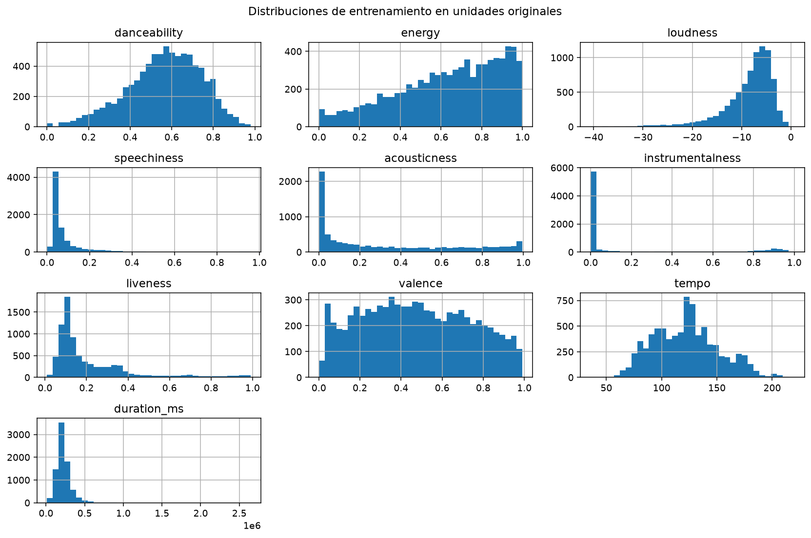

| variable | skew_raw | skew_selected | iqr_outlier_fraction |
| --- | --- | --- | --- |
| danceability | -0.43405 | -0.04408 | 0.00762 |
| energy | -0.55321 | -0.16292 | 0.00000 |
| loudness | -1.91674 | 0.01036 | 0.05187 |
| speechiness | 4.44129 | 0.69202 | 0.12200 |
| acousticness | 0.66815 | 0.22064 | 0.00000 |
| instrumentalness | 1.59588 | 1.17194 | 0.21838 |
| liveness | 2.09403 | 0.38095 | 0.07925 |
| valence | 0.09873 | -0.03096 | 0.00000 |
| tempo | 0.28609 | -0.01658 | 0.00525 |
| duration_ms | 4.70301 | 0.04099 | 0.04600 |

Los extremos IQR se describen, no se eliminan automáticamente: instrumentalidad o habla elevadas pueden ser legítimas. Yeo-Johnson transforma las distribuciones marginales y después estandariza; no garantiza gaussianidad conjunta ni mejores agrupamientos. StandardScaler iguala escalas, pero no elimina asimetría.

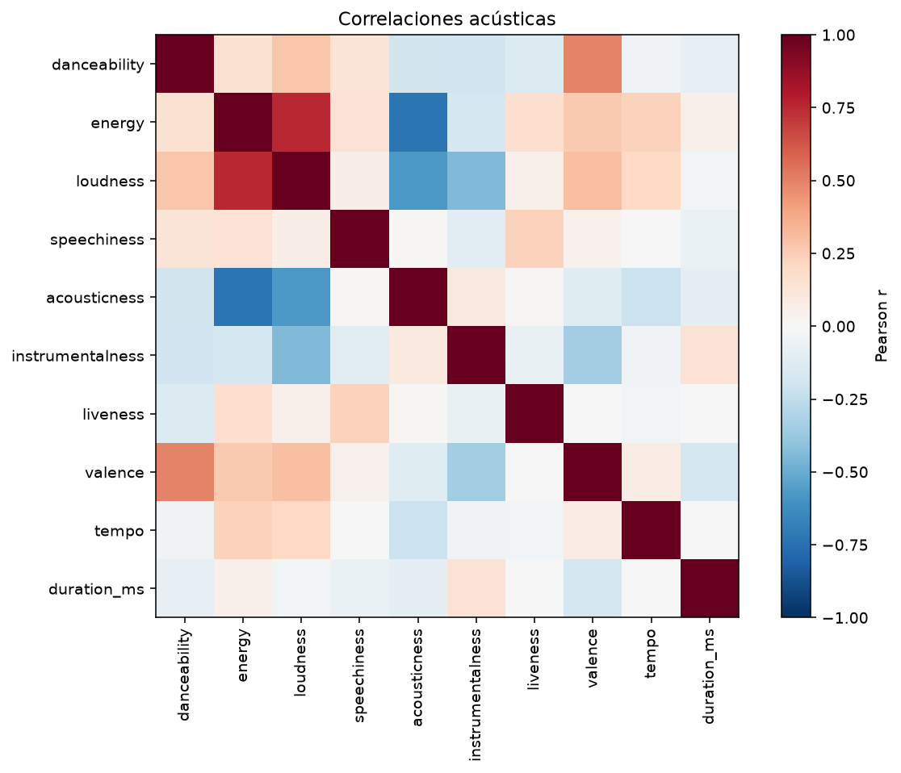

energy/loudness: r=+0.753; energy/acousticness: r=-0.727; loudness/acousticness: r=-0.572. Las correlaciones anticipan redundancia parcial, no autorizan a descartar información sin comparar.

## 3. Protocolo y selección

El protocolo se escribió antes de ejecutar la nueva búsqueda y se conserva con huella SHA-256. Esta revisión es exploratoria y está informada por la versión anterior; no se presenta como prerregistro externo. No se usa la prueba adicional para seleccionar. El test anterior ya observado tampoco selecciona.

| preparacion | silhouette_validacion_media |
| --- | --- |
| standard | 0.22184 |
| yeo_johnson | 0.22702 |

Regla común: maximizar Silhouette en validación, calculado siempre en las diez variables estandarizadas por el escalador de referencia. Se exige al menos 2 % por grupo en ajuste y validación. Dentro de 0,005 del máximo se prefiere menor K; a igualdad de K, menor BIC para GMM. Para cambiar de preparación se exige ganancia media superior a 0,005 en las cuatro configuraciones. Es una regla explícita de parsimonia, no una prueba de significación.

BIC y AIC se calculan como diagnósticos de densidad, pero no se priorizan sobre la utilidad de segmentación. Este cambio de objetivo respecto a la versión anterior se declara; no prueba que la densidad GMM ahora esté mejor ajustada. BIC no se compara entre espacios o transformaciones diferentes. La geometría común favorece por definición conservar la representación estandarizada original.

| preprocessing | model | space | k | covariance | val_sil_common | bic | min_train_fraction | min_val_fraction |
| --- | --- | --- | --- | --- | --- | --- | --- | --- |
| standard | KMeans | original | 2 | — | 0.26763 | — | 0.26729 | 0.24389 |
| standard | GMM | original | 2 | full | 0.15996 | 101373.47493 | 0.35750 | 0.31640 |
| standard | KMeans | pca | 2 | — | 0.27007 | — | 0.26859 | 0.24389 |
| standard | GMM | pca | 3 | diag | 0.18968 | 106232.78906 | 0.16713 | 0.15432 |
| yeo_johnson | KMeans | original | 2 | — | 0.21239 | — | 0.37650 | 0.34044 |
| yeo_johnson | GMM | original | 2 | diag | 0.25864 | 145689.02360 | 0.25420 | 0.23691 |
| yeo_johnson | KMeans | pca | 2 | — | 0.21235 | — | 0.37558 | 0.34083 |
| yeo_johnson | GMM | pca | 2 | diag | 0.22470 | 112990.42294 | 0.34551 | 0.31330 |

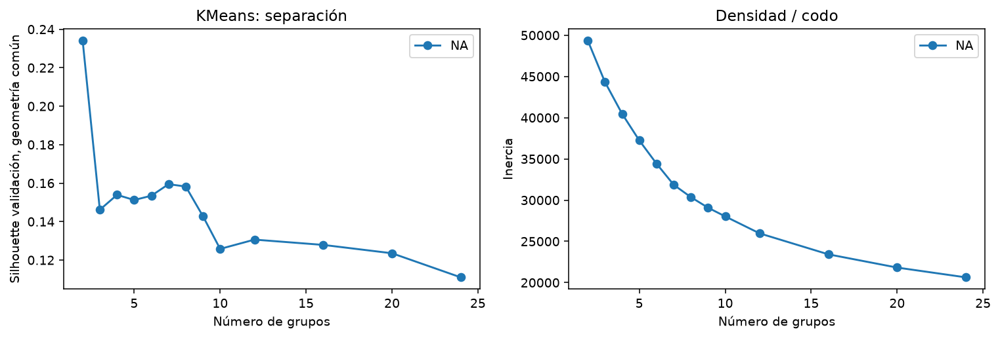

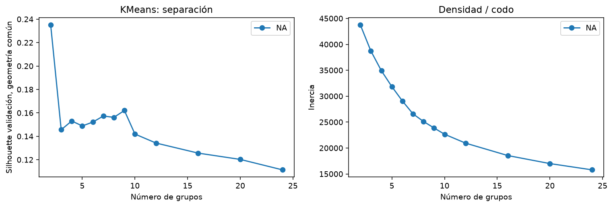

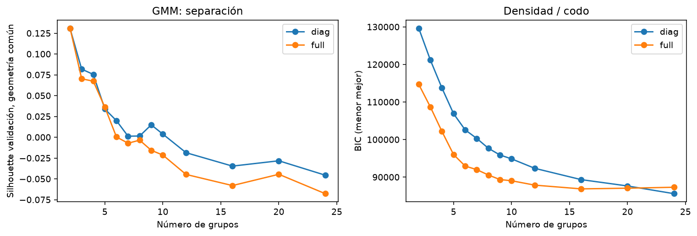

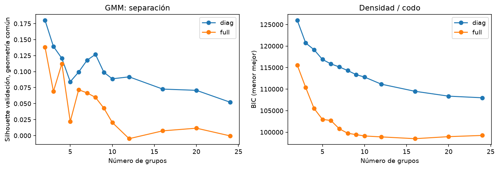

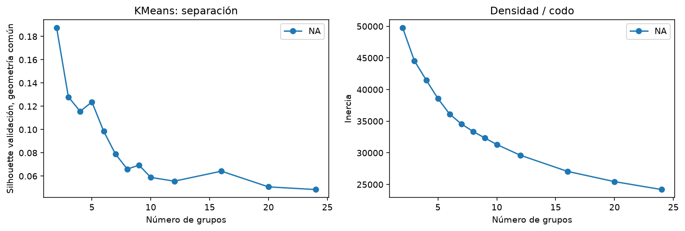

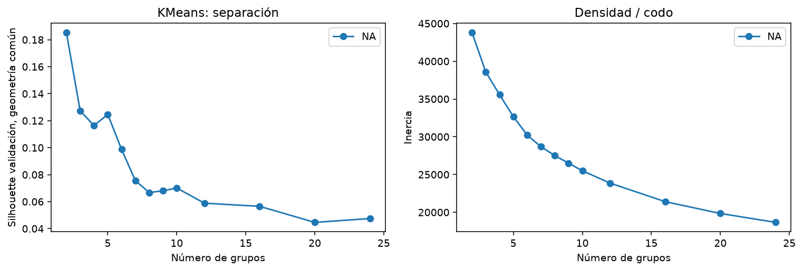

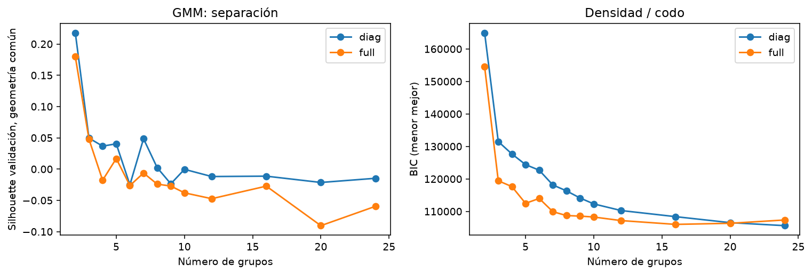

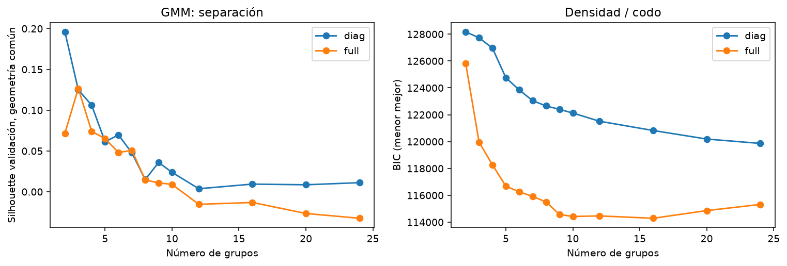

## 4. PCA e interpretación

Umbral fijado en 90 %: se retienen 7 componentes y 90.24%. PC1+PC2 muestran solo 44.03%; no son todo el espacio del modelo.

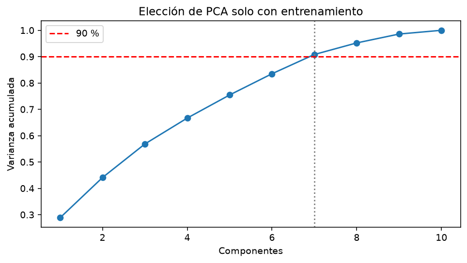

| variable | PC1 | PC2 |
| --- | --- | --- |
| danceability | 0.22364 | 0.47430 |
| energy | 0.52010 | -0.24688 |
| loudness | 0.50637 | -0.06452 |
| speechiness | 0.25429 | 0.04631 |
| acousticness | -0.42743 | 0.32746 |
| instrumentalness | -0.21128 | -0.40013 |
| liveness | 0.08677 | -0.11844 |
| valence | 0.28404 | 0.51935 |
| tempo | 0.20673 | -0.16718 |
| duration_ms | 0.01124 | -0.35881 |

PC1: energy (+0.520), loudness (+0.506), acousticness (-0.427), valence (+0.284). El componente contrasta los atributos positivos y negativos indicados. Si se selecciona Yeo-Johnson, las cargas corresponden a características transformadas, no a relaciones lineales con las unidades físicas originales. El signo global es arbitrario.

PC2: valence (+0.519), danceability (+0.474), instrumentalness (-0.400), duration_ms (-0.359). El componente contrasta los atributos positivos y negativos indicados. Si se selecciona Yeo-Johnson, las cargas corresponden a características transformadas, no a relaciones lineales con las unidades físicas originales. El signo global es arbitrario.

PC1 contrapone intensidad y nivel sonoro (energy y loudness) frente a carácter acústico (acousticness). En términos musicales, resume un eje de sonido más intenso/producido frente a textura más acústica; no clasifica automáticamente géneros ni calidad.

PC2 contrapone valencia y bailabilidad frente a instrumentalidad y duración. Describe un eje de positividad sonora y ritmo bailable frente a formatos más largos o instrumentales. Son interpretaciones descriptivas de las cargas observadas, no emociones del oyente ni una receta de éxito.

## 5. Tabla comparativa obligatoria y comparación justa

Original significa diez características preparadas, sin PCA. Native usa la geometría de cada ajuste; reference_original siempre utiliza las diez características con StandardScaler de referencia. Solo estas últimas filas permiten comparar separaciones en la misma geometría. Se incluyen entrenamiento y prueba, hiperparámetros, grupos, tres métricas, tiempos y ARI. Ruido=0 porque ambos asignan todas las canciones; no equivale a detectar ausencia de anomalías.

| model | space | preprocessing | split | evaluation_space | hyperparameters | groups | noise_pct | fit_seconds | predict_seconds | ari_vs_original | silhouette | davies_bouldin | calinski_harabasz |
| --- | --- | --- | --- | --- | --- | --- | --- | --- | --- | --- | --- | --- | --- |
| KMeans | original | yeo_johnson | train | native | {"k": 2, "covariance": "NA"} | 2 | 0.00000 | 0.04909 | 0.00023 | — | 0.18589 | 1.90763 | 1898.50009 |
| KMeans | original | yeo_johnson | train | reference_original | {"k": 2, "covariance": "NA"} | 2 | 0.00000 | 0.04909 | 0.00023 | — | 0.20235 | 1.89857 | 1803.58292 |
| KMeans | original | yeo_johnson | test | native | {"k": 2, "covariance": "NA"} | 2 | 0.00000 | 0.04909 | 0.00023 | — | 0.16805 | 2.01007 | 421.42814 |
| KMeans | original | yeo_johnson | test | reference_original | {"k": 2, "covariance": "NA"} | 2 | 0.00000 | 0.04909 | 0.00023 | — | 0.18199 | 2.01548 | 366.21130 |
| GMM | original | yeo_johnson | train | native | {"k": 2, "covariance": "diag"} | 2 | 0.00000 | 0.07896 | 0.00024 | — | 0.18612 | 1.80095 | 1631.20299 |
| GMM | original | yeo_johnson | train | reference_original | {"k": 2, "covariance": "diag"} | 2 | 0.00000 | 0.07896 | 0.00024 | — | 0.23257 | 1.70114 | 1779.81302 |
| GMM | original | yeo_johnson | test | native | {"k": 2, "covariance": "diag"} | 2 | 0.00000 | 0.07896 | 0.00024 | — | 0.16256 | 1.86835 | 361.89801 |
| GMM | original | yeo_johnson | test | reference_original | {"k": 2, "covariance": "diag"} | 2 | 0.00000 | 0.07896 | 0.00024 | — | 0.20539 | 1.76146 | 365.99909 |
| KMeans | pca | yeo_johnson | train | native | {"k": 2, "covariance": "NA"} | 2 | 0.00000 | 0.04949 | 0.00021 | 0.99097 | 0.20508 | 1.78478 | 2153.91909 |
| KMeans | pca | yeo_johnson | train | reference_original | {"k": 2, "covariance": "NA"} | 2 | 0.00000 | 0.04949 | 0.00021 | 0.99097 | 0.20213 | 1.90014 | 1802.12722 |
| KMeans | pca | yeo_johnson | test | native | {"k": 2, "covariance": "NA"} | 2 | 0.00000 | 0.04949 | 0.00021 | 0.98399 | 0.18741 | 1.87137 | 486.95178 |
| KMeans | pca | yeo_johnson | test | reference_original | {"k": 2, "covariance": "NA"} | 2 | 0.00000 | 0.04949 | 0.00021 | 0.98399 | 0.18168 | 2.01938 | 365.78626 |
| GMM | pca | yeo_johnson | train | native | {"k": 2, "covariance": "diag"} | 2 | 0.00000 | 0.03653 | 0.00022 | 0.63069 | 0.20779 | 1.76404 | 2128.65097 |
| GMM | pca | yeo_johnson | train | reference_original | {"k": 2, "covariance": "diag"} | 2 | 0.00000 | 0.03653 | 0.00022 | 0.63069 | 0.21143 | 1.86209 | 1825.09869 |
| GMM | pca | yeo_johnson | test | native | {"k": 2, "covariance": "diag"} | 2 | 0.00000 | 0.03653 | 0.00022 | 0.60078 | 0.18683 | 1.84521 | 474.82805 |
| GMM | pca | yeo_johnson | test | reference_original | {"k": 2, "covariance": "diag"} | 2 | 0.00000 | 0.03653 | 0.00022 | 0.60078 | 0.18477 | 1.96955 | 367.00936 |

Silhouette: mayor mejor, cohesión frente a separación. Davies-Bouldin: menor mejor, similitud entre grupos. Calinski-Harabasz: mayor mejor, dispersión entre grupos respecto a dispersión interna. Favorecen agrupamientos compactos y no son medidas de gusto o éxito. Silhouette usa hasta 2.000 observaciones con semilla fija; las otras métricas usan el conjunto completo.

## 6. Estabilidad y costo

| model | space | kind | mean | min | max |
| --- | --- | --- | --- | --- | --- |
| GMM | original | seed | 1.00000 | 1.00000 | 1.00000 |
| GMM | original | subsample | 0.95423 | 0.92796 | 0.98697 |
| GMM | pca | seed | 0.99094 | 0.98188 | 1.00000 |
| GMM | pca | subsample | 0.95635 | 0.94024 | 0.96590 |
| KMeans | original | seed | 0.99666 | 0.99398 | 0.99799 |
| KMeans | original | subsample | 0.95667 | 0.92703 | 0.97206 |
| KMeans | pca | seed | 0.99399 | 0.98798 | 1.00000 |
| KMeans | pca | subsample | 0.95700 | 0.92701 | 0.97405 |

Cuatro semillas y cuatro submuestras de 80 % por configuración; ARI entre pares sobre las mismas canciones de prueba. Transformación y PCA permanecen fijos: mide estabilidad condicional de los modelos. No se selecciona con esta prueba. La incertidumbre de toda la preparación requiere remuestrear el pipeline completo.

| model | space | fit_seconds_median | fit_seconds_min | fit_seconds_max | predict_seconds_median | predict_seconds_min | predict_seconds_max |
| --- | --- | --- | --- | --- | --- | --- | --- |
| GMM | original | 0.09131 | 0.07840 | 0.11683 | 0.00029 | 0.00029 | 0.00031 |
| GMM | pca | 0.03448 | 0.03355 | 0.04129 | 0.00031 | 0.00030 | 0.00032 |
| KMeans | original | 0.04870 | 0.04657 | 0.09640 | 0.00025 | 0.00025 | 0.00029 |
| KMeans | pca | 0.04699 | 0.04557 | 0.04752 | 0.00025 | 0.00024 | 0.00031 |

Preparación final compartida (incluye representación de referencia y PCA): 0.3446 s. Los tiempos repetidos de modelos excluyen búsqueda y preparación, usan un hilo numérico y no son una garantía de rendimiento en otro equipo.

## 7. Interpretación y acciones por perfil

### KMeans_original

| cluster | n | danceability | energy | loudness | speechiness | acousticness | instrumentalness | liveness | valence | tempo | duration_ms |
| --- | --- | --- | --- | --- | --- | --- | --- | --- | --- | --- | --- |
| 0 | 2904 | 0.51100 | 0.37900 | -11.29650 | 0.03810 | 0.71300 | 0.00045 | 0.12000 | 0.32050 | 111.05200 | 209915.00000 |
| 1 | 5096 | 0.61900 | 0.80200 | -5.73900 | 0.06000 | 0.05130 | 0.00002 | 0.14600 | 0.55000 | 125.98050 | 213265.00000 |

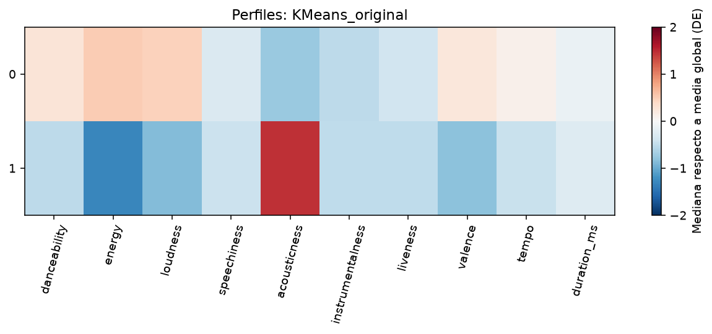

Grupo 0: intermedio, acústico, 111.1 BPM, 3.50 min; 2904 canciones. Acción: filtrar referencias con esta combinación y contrastarlas por escucha. No prescribe una mezcla, género verdadero o público objetivo.

Grupo 1: intenso, mixto, 126.0 BPM, 3.55 min; 5096 canciones. Acción: filtrar referencias con esta combinación y contrastarlas por escucha. No prescribe una mezcla, género verdadero o público objetivo.

### GMM_original

| cluster | n | danceability | energy | loudness | speechiness | acousticness | instrumentalness | liveness | valence | tempo | duration_ms |
| --- | --- | --- | --- | --- | --- | --- | --- | --- | --- | --- | --- |
| 0 | 1948 | 0.49450 | 0.30550 | -12.40400 | 0.03870 | 0.83150 | 0.00102 | 0.11700 | 0.31200 | 109.98850 | 196297.50000 |
| 1 | 6052 | 0.60500 | 0.76200 | -6.19300 | 0.05490 | 0.07690 | 0.00003 | 0.14100 | 0.51400 | 124.90900 | 215928.50000 |

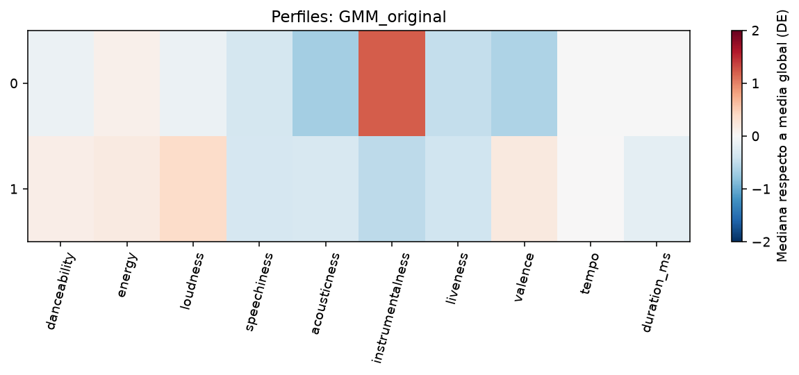

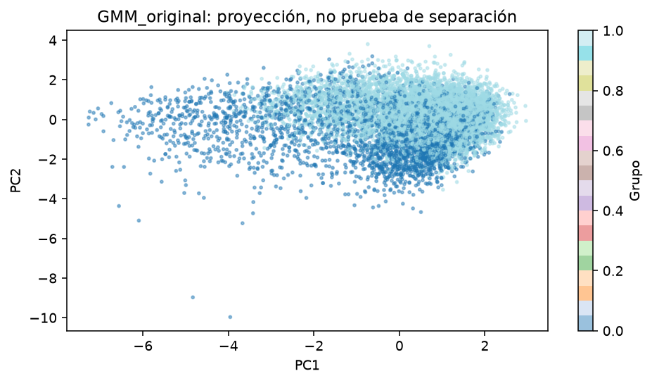

Grupo 0: suave, acústico, 110.0 BPM, 3.27 min; 1948 canciones. Acción: filtrar referencias con esta combinación y contrastarlas por escucha. No prescribe una mezcla, género verdadero o público objetivo.

Grupo 1: intenso, mixto, 124.9 BPM, 3.60 min; 6052 canciones. Acción: filtrar referencias con esta combinación y contrastarlas por escucha. No prescribe una mezcla, género verdadero o público objetivo.

### KMeans_pca

| cluster | n | danceability | energy | loudness | speechiness | acousticness | instrumentalness | liveness | valence | tempo | duration_ms |
| --- | --- | --- | --- | --- | --- | --- | --- | --- | --- | --- | --- |
| 0 | 5094 | 0.61900 | 0.80250 | -5.73750 | 0.06000 | 0.05140 | 0.00002 | 0.14600 | 0.54900 | 125.98200 | 213189.50000 |
| 1 | 2906 | 0.51100 | 0.37900 | -11.32150 | 0.03820 | 0.71300 | 0.00045 | 0.12000 | 0.32100 | 111.02800 | 210046.50000 |

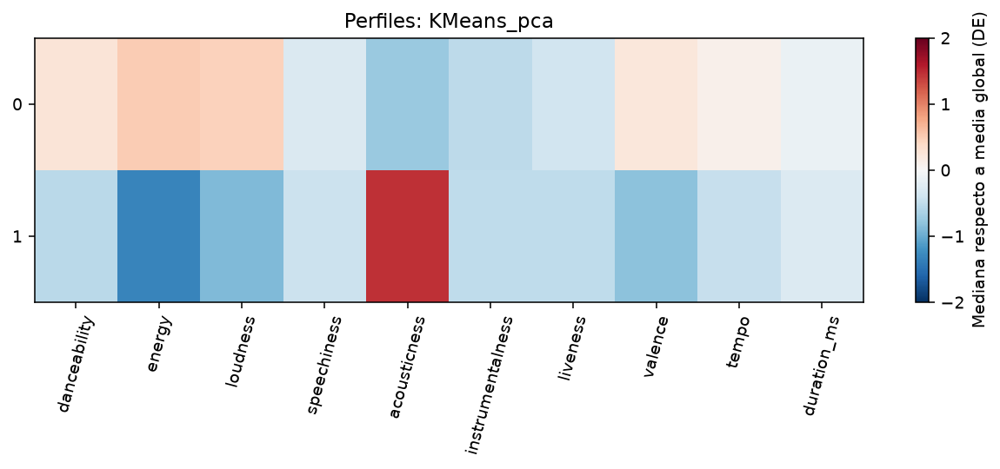

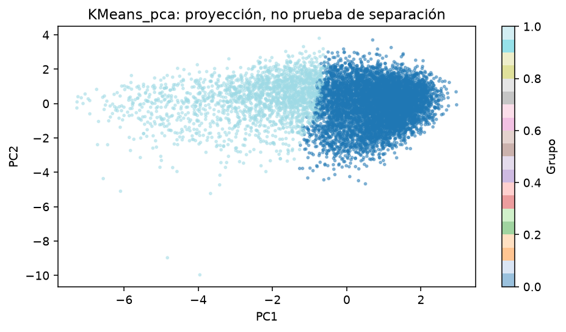

Grupo 0: intenso, mixto, 126.0 BPM, 3.55 min; 5094 canciones. Acción: filtrar referencias con esta combinación y contrastarlas por escucha. No prescribe una mezcla, género verdadero o público objetivo.

Grupo 1: intermedio, acústico, 111.0 BPM, 3.50 min; 2906 canciones. Acción: filtrar referencias con esta combinación y contrastarlas por escucha. No prescribe una mezcla, género verdadero o público objetivo.

### GMM_pca

| cluster | n | danceability | energy | loudness | speechiness | acousticness | instrumentalness | liveness | valence | tempo | duration_ms |
| --- | --- | --- | --- | --- | --- | --- | --- | --- | --- | --- | --- |
| 0 | 5288 | 0.62200 | 0.79700 | -5.83800 | 0.05900 | 0.05550 | 0.00002 | 0.14500 | 0.55000 | 125.03600 | 213345.50000 |
| 1 | 2712 | 0.49900 | 0.36450 | -11.55800 | 0.03795 | 0.73100 | 0.00057 | 0.12000 | 0.30800 | 110.99600 | 208513.00000 |

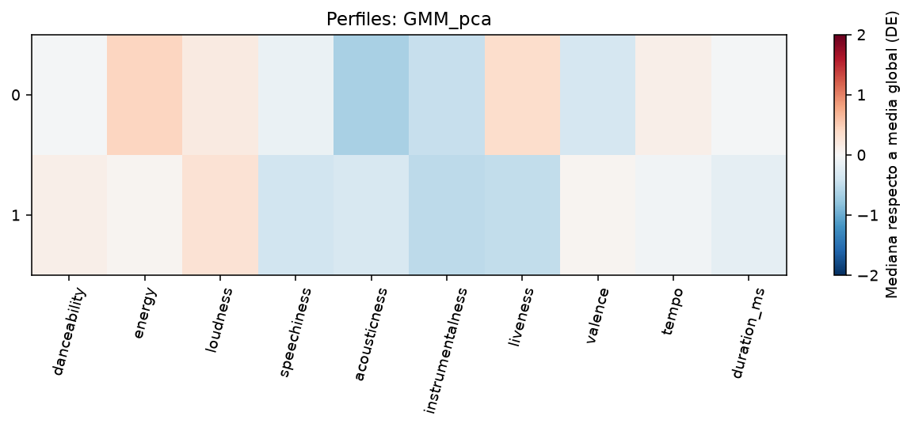

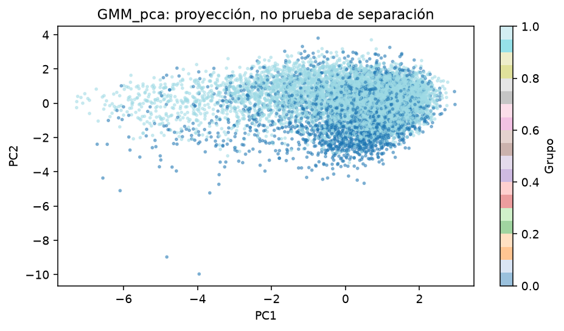

Grupo 0: intenso, mixto, 125.0 BPM, 3.56 min; 5288 canciones. Acción: filtrar referencias con esta combinación y contrastarlas por escucha. No prescribe una mezcla, género verdadero o público objetivo.

Grupo 1: intermedio, acústico, 111.0 BPM, 3.48 min; 2712 canciones. Acción: filtrar referencias con esta combinación y contrastarlas por escucha. No prescribe una mezcla, género verdadero o público objetivo.

### Popularidad como análisis secundario

| model | space | split | cluster | n | median | q25 | q75 |
| --- | --- | --- | --- | --- | --- | --- | --- |
| KMeans | original | test | 0 | 747 | 39.00000 | 23.00000 | 51.50000 |
| KMeans | original | test | 1 | 1253 | 33.00000 | 21.00000 | 46.00000 |
| KMeans | original | train | 0 | 2904 | 32.00000 | 19.00000 | 47.00000 |
| KMeans | original | train | 1 | 5096 | 33.00000 | 19.00000 | 48.00000 |
| GMM | original | test | 0 | 484 | 39.00000 | 22.00000 | 52.00000 |
| GMM | original | test | 1 | 1516 | 34.00000 | 21.00000 | 48.00000 |
| GMM | original | train | 0 | 1948 | 28.00000 | 17.00000 | 46.00000 |
| GMM | original | train | 1 | 6052 | 34.00000 | 20.00000 | 48.00000 |
| KMeans | pca | test | 0 | 1249 | 33.00000 | 21.00000 | 47.00000 |
| KMeans | pca | test | 1 | 751 | 39.00000 | 23.00000 | 51.00000 |
| KMeans | pca | train | 0 | 5094 | 34.00000 | 19.00000 | 48.00000 |
| KMeans | pca | train | 1 | 2906 | 32.00000 | 19.00000 | 47.00000 |
| GMM | pca | test | 0 | 1316 | 33.00000 | 21.00000 | 46.00000 |
| GMM | pca | test | 1 | 684 | 40.00000 | 23.00000 | 52.00000 |
| GMM | pca | train | 0 | 5288 | 34.00000 | 19.75000 | 48.00000 |
| GMM | pca | train | 1 | 2712 | 32.00000 | 18.00000 | 47.00000 |

Las medianas y cuartiles describen el archivo. Las diferencias no garantizan éxito individual ni prueban causalidad. La validación por artistas cambia la población: no se comparan sin más estas cifras con las del test anterior.

## 8. Las doce respuestas de la rúbrica

### 1. Escalado

| model | ari_scaled_unscaled | silhouette_scaled_common | silhouette_unscaled_labels_common |
| --- | --- | --- | --- |
| KMeans | 0.00381 | 0.20235 | 0.13187 |
| GMM | 0.05884 | 0.23257 | 0.16527 |

Duración en milisegundos domina distancias sin escalar frente a variables 0–1. El control conserva hiperparámetros y evalúa sus etiquetas en la misma geometría común. El ARI cuantifica el cambio de partición y evita concluir por un Silhouette medido con otra escala.

### 2. Elección de hiperparámetros

| model | space | k | covariance | val_sil_common | bic |
| --- | --- | --- | --- | --- | --- |
| KMeans | original | 2 | NA | 0.21239 | — |
| GMM | original | 2 | diag | 0.25864 | 145689.02360 |
| KMeans | pca | 2 | NA | 0.21235 | — |
| GMM | pca | 2 | diag | 0.22470 | 112990.42294 |

La búsqueda y sus curvas abarcan K=2–10,12,16,20,24 y covarianzas full/diag para GMM. Se prioriza separación de validación con tamaños mínimos y parsimonia; BIC explica ajuste de densidad, distinto del objetivo de segmentación. La tabla completa conserva todos los intentos, no solo ganadores.

### 3. Sesgo de las métricas

| model | space | silhouette | davies_bouldin | calinski_harabasz |
| --- | --- | --- | --- | --- |
| KMeans | original | 0.18199 | 2.01548 | 366.21130 |
| GMM | original | 0.20539 | 1.76146 | 365.99909 |
| KMeans | pca | 0.18168 | 2.01938 | 365.78626 |
| GMM | pca | 0.18477 | 1.96955 | 367.00936 |

El objetivo euclidiano y el criterio favorecen a K-Means y a gaussianas compactas. Las nubes superpuestas en los mapas advierten que los perfiles pueden ser discretizaciones de un continuo. La proyección PC1/PC2 no prueba separación en todas las dimensiones; contrastar con estas métricas y no solo colores.

### 4. Ruido y atípicos

| variable | skew_raw | skew_selected | iqr_outlier_fraction |
| --- | --- | --- | --- |
| danceability | -0.43405 | -0.04408 | 0.00762 |
| energy | -0.55321 | -0.16292 | 0.00000 |
| loudness | -1.91674 | 0.01036 | 0.05187 |
| speechiness | 4.44129 | 0.69202 | 0.12200 |
| acousticness | 0.66815 | 0.22064 | 0.00000 |
| instrumentalness | 1.59588 | 1.17194 | 0.21838 |
| liveness | 2.09403 | 0.38095 | 0.07925 |
| valence | 0.09873 | -0.03096 | 0.00000 |
| tempo | 0.28609 | -0.01658 | 0.00525 |
| duration_ms | 4.70301 | 0.04099 | 0.04600 |

No se utilizó DBSCAN. K-Means y GMM asignan todos los puntos: ruido 0 % es una propiedad del método. Los atípicos pueden desplazar centroides y covarianzas. No se eliminan perfiles musicales válidos por IQR; se compara una transformación marginal predefinida y se describen sus límites.

### 5. Componentes principales

7 componentes, varianza 90.24%; dos primeras dimensiones 44.03%.

| variable | PC1 | PC2 |
| --- | --- | --- |
| danceability | 0.22364 | 0.47430 |
| energy | 0.52010 | -0.24688 |
| loudness | 0.50637 | -0.06452 |
| speechiness | 0.25429 | 0.04631 |
| acousticness | -0.42743 | 0.32746 |
| instrumentalness | -0.21128 | -0.40013 |
| liveness | 0.08677 | -0.11844 |
| valence | 0.28404 | 0.51935 |
| tempo | 0.20673 | -0.16718 |
| duration_ms | 0.01124 | -0.35881 |

Las mayores cargas absolutas de la sección 4 definen los contrastes acústicos; se interpretan con sus signos. La varianza retenida no es porcentaje de información musical ni de éxito explicado.

### 6. Efecto de la reducción

KMeans, prueba en geometría común: Silhouette 0.1820 → 0.1817; Davies-Bouldin 2.0155 → 2.0194; Calinski-Harabasz 366.21 → 365.79. PCA puede quitar redundancia o descartar diferencias útiles; las cifras no identifican por sí solas cuál causa actuó. Diez variables no justifican invocar automáticamente maldición de dimensionalidad.

GMM, prueba en geometría común: Silhouette 0.2054 → 0.1848; Davies-Bouldin 1.7615 → 1.9695; Calinski-Harabasz 366.00 → 367.01. PCA puede quitar redundancia o descartar diferencias útiles; las cifras no identifican por sí solas cuál causa actuó. Diez variables no justifican invocar automáticamente maldición de dimensionalidad.

### 7. Comparación justa

| model | space | evaluation_space | silhouette | davies_bouldin | calinski_harabasz |
| --- | --- | --- | --- | --- | --- |
| KMeans | original | native | 0.18589 | 1.90763 | 1898.50009 |
| KMeans | original | reference_original | 0.20235 | 1.89857 | 1803.58292 |
| GMM | original | native | 0.18612 | 1.80095 | 1631.20299 |
| GMM | original | reference_original | 0.23257 | 1.70114 | 1779.81302 |
| KMeans | pca | native | 0.20508 | 1.78478 | 2153.91909 |
| KMeans | pca | reference_original | 0.20213 | 1.90014 | 1802.12722 |
| GMM | pca | native | 0.20779 | 1.76404 | 2128.65097 |
| GMM | pca | reference_original | 0.21143 | 1.86209 | 1825.09869 |

Comparar Native original con Native PCA mezcla geometrías. La conclusión de separación utiliza reference_original. Cuando las conclusiones difieren, se prioriza esta geometría declarada y se reconoce el sesgo a favor de preservarla.

### 8. Cambio de asignaciones

| model | split | ari_vs_original |
| --- | --- | --- |
| KMeans | train | 0.99097 |
| KMeans | test | 0.98399 |
| GMM | train | 0.63069 |
| GMM | test | 0.60078 |

ARI=1 implica particiones equivalentes aun con etiquetas permutadas; cercano a cero es acuerdo compatible con azar. Puede ser negativo. Se compara el mismo conjunto en cada fila y no popularidad o género.

### 9. Estabilidad

| model | space | kind | mean | min | max |
| --- | --- | --- | --- | --- | --- |
| GMM | original | seed | 1.00000 | 1.00000 | 1.00000 |
| GMM | original | subsample | 0.95423 | 0.92796 | 0.98697 |
| GMM | pca | seed | 0.99094 | 0.98188 | 1.00000 |
| GMM | pca | subsample | 0.95635 | 0.94024 | 0.96590 |
| KMeans | original | seed | 0.99666 | 0.99398 | 0.99799 |
| KMeans | original | subsample | 0.95667 | 0.92703 | 0.97206 |
| KMeans | pca | seed | 0.99399 | 0.98798 | 1.00000 |
| KMeans | pca | subsample | 0.95700 | 0.92701 | 0.97405 |

En original, mayor ARI medio condicional: GMM=0.9771; KMeans=0.9767. K-Means puede variar por centroides iniciales; GMM añade sensibilidad de covarianzas y máximos locales. Un ARI alto no prueba que los grupos sean verdaderos.

En pca, mayor ARI medio condicional: KMeans=0.9755; GMM=0.9736. K-Means puede variar por centroides iniciales; GMM añade sensibilidad de covarianzas y máximos locales. Un ARI alto no prueba que los grupos sean verdaderos.

### 10. Costo computacional

| model | space | fit_seconds_median | fit_seconds_min | fit_seconds_max | predict_seconds_median | predict_seconds_min | predict_seconds_max |
| --- | --- | --- | --- | --- | --- | --- | --- |
| GMM | original | 0.09131 | 0.07840 | 0.11683 | 0.00029 | 0.00029 | 0.00031 |
| GMM | pca | 0.03448 | 0.03355 | 0.04129 | 0.00031 | 0.00030 | 0.00032 |
| KMeans | original | 0.04870 | 0.04657 | 0.09640 | 0.00025 | 0.00025 | 0.00029 |
| KMeans | pca | 0.04699 | 0.04557 | 0.04752 | 0.00025 | 0.00024 | 0.00031 |

Con 100 veces más observaciones no se extrapolan segundos ciegamente. K-Means escala aproximadamente O(n·K·d·iteraciones); GMM full añade operaciones de covarianza O(n·K·d²) y factorización O(K·d³) por iteración. Reducir d puede ayudar a GMM, pero depende también de convergencia. Silhouette completo tiene costo cuadrático en n; mantener muestreo. Incluir ajuste/transformación PCA antes de afirmar ahorro total.

### 11. Visualización no lineal

No se ejecutó UMAP ni t-SNE: son opcionales. PCA muestra 44.03% en dos ejes y no todo el espacio. Islas en una visualización no lineal hipotética no demostrarían grupos naturales. t-SNE altera distancias globales y densidades, depende de parámetros y no es entrada de este clustering.

### 12. Recomendación final

Se recomienda provisionalmente GMM_original, elegido en validación con Silhouette común=0.2586; no se cambia por los resultados de prueba ni popularidad. Revisar conjuntamente las tres métricas, estabilidad, tamaños y perfiles, y reconocer que diferencias pequeñas no demuestran superioridad estadística.

Limitaciones: muestra histórica de conveniencia; exclusión por artistas modifica la población y no equivale a evaluación temporal; versiones no detectadas; características agregadas omiten melodía, letra y secciones; sin evaluación de oyentes. Con más tiempo: validación temporal/externa, remuestreo de toda la preparación, protocolo humano y medidas longitudinales de exposición/promoción.

## 9. Cierre con canciones reales

Hay 53 consultas de popularidad ≥70 con al menos una referencia ≤30 dentro del mismo perfil. La pareja siguiente minimiza su distancia en las diez variables estandarizadas; es un ejemplo deliberadamente seleccionado para ilustrar similitud con popularidades distintas, no prueba representativa de todas las canciones.

| distance | high_song | high_artist | high_id | high_popularity | low_song | low_artist | low_id | low_popularity | configuration |
| --- | --- | --- | --- | --- | --- | --- | --- | --- | --- |
| 0.42844 | Drunk (And I Don't Wanna Go Home) | Elle King;Miranda Lambert | 0QULNNd9z5s35entfiiXoa | 75 | Kumm loss mer danze | Höhner | 6aZMMPBl5FuOamKDBPzfNL | 26 | GMM_original |
| 0.45817 | Cinderella | Cyril Kamer | 5R7l05dglCrUX0qjZ1Eec1 | 77 | Cu-Step (Cupid Shuffle Pt. 2) | Cupid | 3dQz2NgEuYwOwtwtYRuflG | 12 | GMM_original |
| 0.53142 | Bumpy Ride | Mohombi | 71R6zJsrF3ffc3TBFHfivX | 72 | Déjate Querer | Lalo Ebratt;Sebastian Yatra;Yera;Trapical Minds | 0PF7SVd93G602xdi8SVyEz | 1 | GMM_original |

| variable | cancion_popular | referencia_menor_popularidad |
| --- | --- | --- |
| danceability | 0.61200 | 0.63100 |
| energy | 0.88400 | 0.88400 |
| loudness | -4.40000 | -4.62900 |
| speechiness | 0.04590 | 0.03240 |
| acousticness | 0.00516 | 0.00630 |
| instrumentalness | 0.00000 | 0.00001 |
| liveness | 0.09970 | 0.10600 |
| valence | 0.62600 | 0.68900 |
| tempo | 119.99100 | 124.98300 |
| duration_ms | 245625.00000 | 219360.00000 |

Abrir las canciones legalmente en Spotify y comprobar mediante escucha si la similitud percibida coincide con las características. No se seleccionó un tramo del audio ni se analizó estructura verso/estribillo; el dataset no contiene audio. Si al escuchar no parecen similares, explicar qué no capturan las variables y no ocultar ese resultado.

Canción A: https://open.spotify.com/track/0QULNNd9z5s35entfiiXoa
Canción B: https://open.spotify.com/track/6aZMMPBl5FuOamKDBPzfNL

### Evaluación humana propuesta, no realizada

Consultas fijadas antes de escuchar, sugerencias original/PCA con etiquetas ocultas, orden alternado y fragmentos de igual duración elegidos de forma consistente. Voluntarios con consentimiento e identificadores anónimos puntúan similitud y utilidad de 1 a 5. Reportar participantes, consultas, distribuciones y comentarios negativos; una muestra pequeña no generaliza a todos los oyentes. No hay puntuaciones humanas inventadas.

## 10. Qué mejoró y qué no puede afirmarse

| model | space | groups_anterior | silhouette_anterior | groups_revision | silhouette_revision | delta_silhouette |
| --- | --- | --- | --- | --- | --- | --- |
| KMeans | original | 2 | 0.24933 | 2 | 0.20235 | -0.04698 |
| KMeans | pca | 2 | 0.24967 | 2 | 0.20213 | -0.04754 |
| GMM | original | 16 | -0.02737 | 2 | 0.23257 | 0.25993 |
| GMM | pca | 15 | 0.01615 | 2 | 0.21143 | 0.19528 |

Esta comparación usa las mismas 8.000 canciones, las mismas diez variables y StandardScaler de referencia. La revisión modifica preparación y selección: no permite atribuir toda la diferencia solo a Yeo-Johnson. Se observa mejora geométrica en GMM y empeoramiento en K-Means; no es una mejora universal, ni demuestra mejor ajuste de densidad o utilidad para oyentes.

La ventaja media de Yeo-Johnson en validación fue +0.00518, frente al umbral predefinido de 0,005. Es pequeña y está cerca del umbral; no se evaluó significación estadística ni robustez a múltiples particiones de validación. No debe presentarse como una superioridad contundente.

Se añadió selección separada por artistas, comparación acotada de preparación, tamaños mínimos, búsqueda hasta 24 grupos, regla común orientada a segmentación, prueba adicional sin artistas previos y benchmarks repetidos. No se cambió la métrica para demostrar éxito: se declaró el cambio respecto al objetivo BIC anterior y se mantienen sus diagnósticos.

Una nueva Silhouette no es directamente comparable con la anterior cuando cambia la población, el ajuste o la geometría. La comparación controlada entre StandardScaler y Yeo-Johnson es la tabla de validación con los mismos datos y referencia. El test reservado es una comprobación posterior, no otra oportunidad de ajuste. Si no mejora, debe reportarse.

## 11. Reproducibilidad y asistencia de IA

Ejecutar Proyecto_Mejorado.ipynb completo o python mejorar_proyecto.py desde esta carpeta. Semillas, criterios, búsqueda completa, IDs de las particiones, huellas y versiones acompañan la entrega. No hace falta descargar audio, abrir una API o tener internet para repetir con el CSV incluido. Se utilizó ChatGPT/Codex para código, documentación y análisis; los estudiantes deben revisar y declarar la asistencia. La preparación no garantiza una calificación.

## Referencias

Pandya, M. (s. f.). Spotify Tracks Dataset [Conjunto de datos]. Hugging Face. https://huggingface.co/datasets/maharshipandya/spotify-tracks-dataset

Pedregosa, F., et al. (2011). Scikit-learn: Machine learning in Python. Journal of Machine Learning Research, 12, 2825–2830. https://jmlr.org/papers/v12/pedregosa11a.html

Scikit-learn developers. (s. f.). PowerTransformer y GroupShuffleSplit [Documentación]. https://scikit-learn.org/stable/modules/generated/sklearn.preprocessing.PowerTransformer.html ; https://scikit-learn.org/stable/modules/generated/sklearn.model_selection.GroupShuffleSplit.html