# ¿Existen perfiles sonoros que concentren canciones de alta popularidad y qué características los distinguen?

Ampliación: perfiles más detallados y contraste por contextos de género. Se conserva la referencia anterior y la comparación K-Means/GMM antes y después de PCA.

## Resumen actualizado

La configuración fina principal, KMeans_original, se eligió por calidad geométrica de validación sin consultar popularidad. El candidato identificado en entrenamiento presenta 4.64% de canciones con popularidad ≥70 frente a 2.98% global en 6000 canciones adicionales: lift 1.55; diferencia frente al resto +2.84 pp, IC95 [+1.86, +3.83]. El perfil fino candidato presenta mayor concentración en esta evaluación adicional, con un intervalo de diferencia completamente positivo.

La referencia de dos grupos presenta lift 1.15 en estas mismas canciones. Los perfiles cubren conjuntos distintos: revisar cobertura y captura de canciones populares antes de interpretar una mayor concentración como mejora útil.

## 1. Ampliación y criterios fijados

Hipótesis: dos grupos amplios pueden ocultar asociaciones dentro de perfiles más específicos o de contextos musicales. Se exploran K=3,4,5,6,8,10 para los dos algoritmos y espacios. Este brazo exige mayor granularidad deliberadamente; no se afirma que mejorar la popularidad requiera más grupos ni que su Silhouette deba superar al de K=2.

Se conserva la preparación previamente congelada. Selección: Silhouette de validación en geometría común, grupos mínimos de 2 %, tolerancia 0,005 y preferencia por K menor y luego BIC. Modelo principal por mayor Silhouette de validación. El conjunto de validación ya fue observado en etapas previas; esta ampliación es exploratoria y usa otra evaluación adicional para contrastar candidatos.

Solo después del ajuste se escoge el perfil de mayor tasa ≥70 en entrenamiento, con al menos 200 observaciones. Los contextos emplean un mínimo de 400 canciones de entrenamiento y 80 por perfil/resto. La lista de contextos y sus reglas se fijaron antes de observar sus tasas. No se seleccionan algoritmos, K o contextos por los resultados de prueba.

| model | space | k | covariance | val_sil_common |
| --- | --- | --- | --- | --- |
| KMeans | original | 4 | NA | 0.15389 |
| KMeans | pca | 4 | NA | 0.15307 |
| GMM | original | 3 | diag | 0.08180 |
| GMM | pca | 3 | diag | 0.13929 |

## 2. Otra evaluación y comparación controlada

Se reservaron 6000 canciones de 12501 elegibles, excluyendo los 14.000 registros usados antes, sus nombres de artistas y los vectores acústicos exactos a siete decimales. El muestreo es uniforme, sin enriquecer artificialmente con canciones populares. Los nombres no son identificadores universales: alias pueden escapar de la exclusión.

Tasa = canciones ≥70 / canciones con popularidad válida. Lift = tasa del perfil / tasa global del mismo conjunto. Cobertura = fracción del catálogo incluida en el perfil. Captura = fracción de todas las canciones ≥70 que están en él. No son precisión predictiva ni efectos causales.

| strategy | configuration | cluster | n | n_profile | high_count | total_high | profile_rate | rest_rate | global_rate | lift | coverage | capture | difference | diff_low | diff_high | lift_low | lift_high | alpha | status |
| --- | --- | --- | --- | --- | --- | --- | --- | --- | --- | --- | --- | --- | --- | --- | --- | --- | --- | --- | --- |
| fino | KMeans_original | 2 | 6000 | 2502 | 116 | 179 | 0.04636 | 0.01801 | 0.02983 | 1.55406 | 0.41700 | 0.64804 | 0.02835 | 0.01862 | 0.03833 | 1.37703 | 1.72410 | 0.05000 | ok |
| fino | KMeans_pca | 0 | 6000 | 2522 | 117 | 179 | 0.04639 | 0.01783 | 0.02983 | 1.55503 | 0.42033 | 0.65363 | 0.02857 | 0.01874 | 0.03852 | 1.37923 | 1.72857 | 0.05000 | ok |
| fino | GMM_original | 0 | 6000 | 3619 | 150 | 179 | 0.04145 | 0.01218 | 0.02983 | 1.38932 | 0.60317 | 0.83799 | 0.02927 | 0.02098 | 0.03758 | 1.29495 | 1.48220 | 0.05000 | ok |
| fino | GMM_pca | 1 | 6000 | 2983 | 131 | 179 | 0.04392 | 0.01591 | 0.02983 | 1.47203 | 0.49717 | 0.73184 | 0.02801 | 0.01903 | 0.03720 | 1.33889 | 1.59838 | 0.05000 | ok |
| referencia | KMeans_pca | 0 | 6000 | 4492 | 154 | 179 | 0.03428 | 0.01658 | 0.02983 | 1.14916 | 0.74867 | 0.86034 | 0.01770 | 0.00851 | 0.02651 | 1.07617 | 1.21697 | 0.05000 | ok |

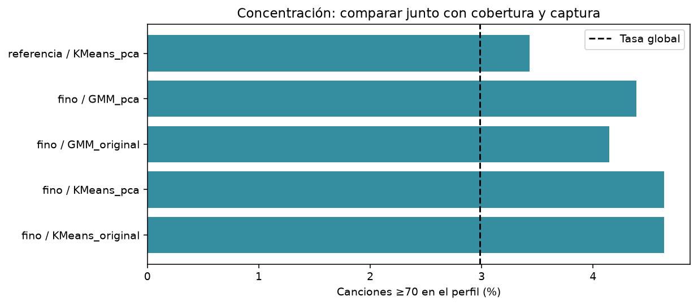

Las cuatro configuraciones finas comparten observaciones; solo la principal fija el contraste global primario. El resto es exploratorio. Los intervalos remuestrean componentes de artistas completos y son condicionales a los modelos ajustados, no a todo el pipeline.

## 3. Contextos musicales: contraste posterior al clustering

El CSV no contiene año, idioma ni estructura del audio. Se utilizan familias editoriales explícitas: electrónica, rock/metal, pop, hip-hop/R&B, latina y acústica/folk/country. Se recuperan todas las etiquetas brutas por ID, en lugar de conservar solo la primera. Una canción puede pertenecer a varios contextos: sus tamaños no se suman y no son confirmaciones independientes.

Género no entra al vector acústico ni determina los hiperparámetros. Dentro de cada contexto elegible se escoge el candidato solo en entrenamiento, entre los perfiles del modelo fino principal. En prueba se exigen 150 canciones del contexto y 30 por candidato/resto; los casos insuficientes se reportan, no se interpretan como ausencia de asociación.

| context | training_songs | eligible |
| --- | --- | --- |
| electronica | 1188 | True |
| rock_metal | 1177 | True |
| pop | 401 | True |
| hiphop_rnb | 262 | False |
| latina | 530 | True |
| acustica_folk_country | 594 | True |

| context | cluster | n | n_profile | high_count | total_high | profile_rate | rest_rate | global_rate | lift | coverage | capture | difference | diff_low | diff_high | lift_low | lift_high | alpha | status |
| --- | --- | --- | --- | --- | --- | --- | --- | --- | --- | --- | --- | --- | --- | --- | --- | --- | --- | --- |
| electronica | 2 | 763 | 221 | 10 | 14 | 0.04525 | 0.00738 | 0.01835 | 2.46606 | 0.28965 | 0.71429 | 0.03787 | 0.00409 | 0.07774 | 1.26152 | 3.63771 | 0.01000 | ok |
| rock_metal | 2 | 869 | 284 | 17 | 37 | 0.05986 | 0.03419 | 0.04258 | 1.40588 | 0.32681 | 0.45946 | 0.02567 | -0.01350 | 0.07000 | 0.76598 | 2.14462 | 0.01000 | ok |
| pop | 2 | 236 | 149 | 32 | 43 | 0.21477 | 0.12644 | 0.18220 | 1.17871 | 0.63136 | 0.74419 | 0.08833 | -0.04333 | 0.21918 | 0.90786 | 1.43316 | 0.01000 | ok |
| latina | 2 | 313 | 230 | 7 | 7 | 0.03043 | 0.00000 | 0.02236 | 1.36087 | 0.73482 | 1.00000 | 0.03043 | 0.00000 | 0.07955 | 1.24054 | 1.51670 | 0.01000 | ok |
| acustica_folk_country | 2 | 485 | 197 | 16 | 29 | 0.08122 | 0.04514 | 0.05979 | 1.35831 | 0.40619 | 0.55172 | 0.03608 | -0.01998 | 0.10103 | 0.76480 | 1.93513 | 0.01000 | ok |

Los contextos secundarios utilizan intervalos bootstrap Bonferroni: alfa=0,05/5 según los contextos elegibles fijados en entrenamiento. La corrección es una aproximación por remuestreo; reduce hallazgos casuales al explorar varios contextos, pero no convierte esta revisión en un estudio causal o externo.

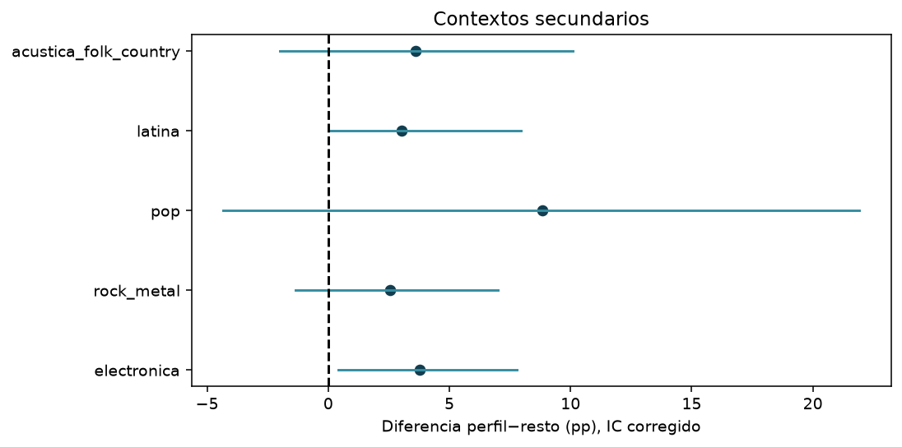

Contextos con intervalo corregido completamente positivo: electronica. Son asociaciones condicionadas a este diseño, no recetas de éxito.

### Sensibilidad descriptiva del candidato principal

| threshold | profile_rate | global_rate | lift |
| --- | --- | --- | --- |
| 60 | 0.14149 | 0.10767 | 1.31412 |
| 80 | 0.00759 | 0.00450 | 1.68754 |

Se mantiene el candidato elegido con umbral 70. Los umbrales 60/80 son comprobaciones descriptivas, no nuevas oportunidades de seleccionar un modelo o declarar confirmación sin sus propios intervalos.

## 4. Rasgos de los perfiles candidatos

| configuration | cluster | variable | profile_median | rest_median | difference | standardized_difference |
| --- | --- | --- | --- | --- | --- | --- |
| KMeans_original | 2 | valence | 0.68800 | 0.30900 | 0.37900 | 1.45045 |
| KMeans_original | 2 | danceability | 0.68800 | 0.48900 | 0.19900 | 1.12713 |
| KMeans_original | 2 | loudness | -6.51800 | -8.16000 | 1.64200 | 0.32114 |
| KMeans_original | 2 | duration_ms | 199035.50000 | 225232.00000 | -26196.50000 | -0.26097 |
| KMeans_original | 2 | energy | 0.69500 | 0.64550 | 0.04950 | 0.19401 |
| KMeans_original | 2 | tempo | 120.00200 | 124.91200 | -4.91000 | -0.16582 |
| KMeans_original | 2 | liveness | 0.12400 | 0.13900 | -0.01500 | -0.07781 |
| KMeans_original | 2 | acousticness | 0.18200 | 0.20550 | -0.02350 | -0.07001 |
| KMeans_original | 2 | speechiness | 0.05190 | 0.04720 | 0.00470 | 0.04087 |
| KMeans_original | 2 | instrumentalness | 0.00000 | 0.00166 | -0.00165 | -0.00514 |
| KMeans_pca | 0 | valence | 0.68300 | 0.30900 | 0.37400 | 1.43131 |
| KMeans_pca | 0 | danceability | 0.68700 | 0.48700 | 0.20000 | 1.13280 |
| KMeans_pca | 0 | loudness | -6.52150 | -8.18950 | 1.66800 | 0.32623 |
| KMeans_pca | 0 | duration_ms | 198823.50000 | 225810.50000 | -26987.00000 | -0.26884 |
| KMeans_pca | 0 | energy | 0.69400 | 0.64800 | 0.04600 | 0.18029 |
| KMeans_pca | 0 | tempo | 120.00400 | 124.92800 | -4.92400 | -0.16629 |
| KMeans_pca | 0 | liveness | 0.12300 | 0.13900 | -0.01600 | -0.08299 |
| KMeans_pca | 0 | speechiness | 0.05145 | 0.04740 | 0.00405 | 0.03522 |
| KMeans_pca | 0 | acousticness | 0.18600 | 0.19400 | -0.00800 | -0.02383 |
| KMeans_pca | 0 | instrumentalness | 0.00000 | 0.00173 | -0.00173 | -0.00537 |
| GMM_original | 0 | instrumentalness | 0.00000 | 0.47700 | -0.47700 | -1.48242 |
| GMM_original | 0 | valence | 0.53700 | 0.30700 | 0.23000 | 0.88022 |
| GMM_original | 0 | loudness | -6.55200 | -9.12600 | 2.57400 | 0.50343 |
| GMM_original | 0 | danceability | 0.59800 | 0.52600 | 0.07200 | 0.40781 |
| GMM_original | 0 | acousticness | 0.21700 | 0.10100 | 0.11600 | 0.34556 |
| GMM_original | 0 | duration_ms | 207066.00000 | 227453.00000 | -20387.00000 | -0.20309 |
| GMM_original | 0 | energy | 0.68000 | 0.65500 | 0.02500 | 0.09799 |
| GMM_original | 0 | liveness | 0.13800 | 0.12200 | 0.01600 | 0.08299 |
| GMM_original | 0 | tempo | 122.48400 | 122.01600 | 0.46800 | 0.01581 |
| GMM_original | 0 | speechiness | 0.04930 | 0.04820 | 0.00110 | 0.00957 |
| GMM_pca | 1 | acousticness | 0.08620 | 0.51400 | -0.42780 | -1.27440 |
| GMM_pca | 1 | energy | 0.75900 | 0.49700 | 0.26200 | 1.02689 |
| GMM_pca | 1 | valence | 0.58600 | 0.33200 | 0.25400 | 0.97207 |
| GMM_pca | 1 | loudness | -5.82700 | -9.66000 | 3.83300 | 0.74966 |
| GMM_pca | 1 | danceability | 0.62900 | 0.51800 | 0.11100 | 0.62870 |
| GMM_pca | 1 | tempo | 124.03200 | 119.97100 | 4.06100 | 0.13715 |
| GMM_pca | 1 | duration_ms | 211176.00000 | 214666.00000 | -3490.00000 | -0.03477 |
| GMM_pca | 1 | liveness | 0.12900 | 0.13400 | -0.00500 | -0.02594 |
| GMM_pca | 1 | speechiness | 0.04920 | 0.04820 | 0.00100 | 0.00870 |
| GMM_pca | 1 | instrumentalness | 0.00001 | 0.00264 | -0.00263 | -0.00818 |

Las medianas están en unidades originales. Las diferencias perfil−resto, estandarizadas por la DE de entrenamiento, describen qué distingue al grupo. No estiman cuánto subiría la popularidad al modificar energía, tempo u otro atributo.

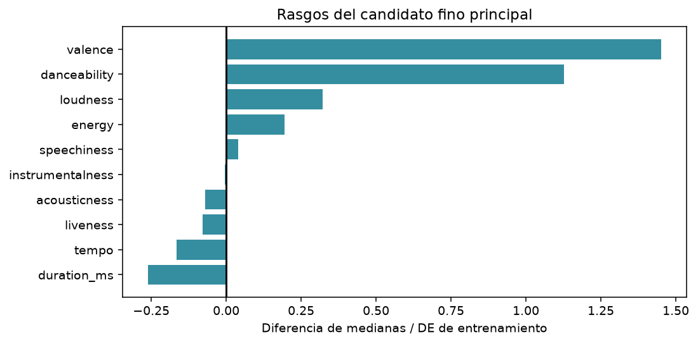

## 5. Calidad y estabilidad de la segmentación ampliada

| model | space | split | evaluation_space | k | covariance | groups | noise_pct | fit_seconds | predict_seconds | ari_vs_original | silhouette | davies_bouldin | calinski_harabasz |
| --- | --- | --- | --- | --- | --- | --- | --- | --- | --- | --- | --- | --- | --- |
| KMeans | original | train | native | 4 | NA | 4 | 0.00000 | 0.81482 | 0.00329 | — | 0.15882 | 1.80508 | 1367.25550 |
| KMeans | original | train | reference_original | 4 | NA | 4 | 0.00000 | 0.81482 | 0.00329 | — | 0.15882 | 1.80508 | 1367.25550 |
| KMeans | original | test | native | 4 | NA | 4 | 0.00000 | 0.81482 | 0.00329 | — | 0.15594 | 1.79970 | 993.67450 |
| KMeans | original | test | reference_original | 4 | NA | 4 | 0.00000 | 0.81482 | 0.00329 | — | 0.15594 | 1.79970 | 993.67450 |
| KMeans | pca | train | native | 4 | NA | 4 | 0.00000 | 0.89721 | 0.00208 | 0.95607 | 0.18297 | 1.66687 | 1580.88268 |
| KMeans | pca | train | reference_original | 4 | NA | 4 | 0.00000 | 0.89721 | 0.00208 | 0.95607 | 0.15948 | 1.80905 | 1366.02481 |
| KMeans | pca | test | native | 4 | NA | 4 | 0.00000 | 0.89721 | 0.00208 | 0.95936 | 0.18064 | 1.65620 | 1149.76398 |
| KMeans | pca | test | reference_original | 4 | NA | 4 | 0.00000 | 0.89721 | 0.00208 | 0.95936 | 0.15687 | 1.79375 | 997.96135 |
| GMM | original | train | native | 3 | diag | 3 | 0.00000 | 1.56558 | 0.00289 | — | 0.07942 | 2.37067 | 786.55080 |
| GMM | original | train | reference_original | 3 | diag | 3 | 0.00000 | 1.56558 | 0.00289 | — | 0.07942 | 2.37067 | 786.55080 |
| GMM | original | test | native | 3 | diag | 3 | 0.00000 | 1.56558 | 0.00289 | — | 0.08597 | 2.32845 | 613.71531 |
| GMM | original | test | reference_original | 3 | diag | 3 | 0.00000 | 1.56558 | 0.00289 | — | 0.08597 | 2.32845 | 613.71531 |
| GMM | pca | train | native | 3 | diag | 3 | 0.00000 | 0.89504 | 0.00271 | 0.15446 | 0.18267 | 2.46270 | 1270.18134 |
| GMM | pca | train | reference_original | 3 | diag | 3 | 0.00000 | 0.89504 | 0.00271 | 0.15446 | 0.16408 | 2.61927 | 1126.53065 |
| GMM | pca | test | native | 3 | diag | 3 | 0.00000 | 0.89504 | 0.00271 | 0.16446 | 0.19865 | 2.47619 | 964.28011 |
| GMM | pca | test | reference_original | 3 | diag | 3 | 0.00000 | 0.89504 | 0.00271 | 0.16446 | 0.17897 | 2.62962 | 859.62173 |

Las filas reference_original usan el mismo escalador de referencia y las mismas canciones para comparar modelos y PCA. Native usa la geometría de cada modelo. Métricas de contextos o muestras distintas no se comparan directamente. Ruido=0 es asignación completa, no ausencia comprobada de anomalías.

| configuration | cluster | n | name | danceability | energy | loudness | speechiness | acousticness | instrumentalness | liveness | valence | tempo | duration_ms |
| --- | --- | --- | --- | --- | --- | --- | --- | --- | --- | --- | --- | --- | --- |
| KMeans_original | 0 | 593 | intenso / mixto | 0.53800 | 0.77000 | -7.11800 | 0.08160 | 0.39000 | 0.00000 | 0.74200 | 0.49400 | 115.13400 | 213760.00000 |
| KMeans_original | 1 | 1665 | suave / acústico | 0.45500 | 0.27100 | -13.55000 | 0.03870 | 0.84800 | 0.01390 | 0.11600 | 0.24700 | 107.09200 | 197850.00000 |
| KMeans_original | 2 | 3376 | intenso / mixto | 0.68800 | 0.69500 | -6.51800 | 0.05190 | 0.18200 | 0.00000 | 0.12400 | 0.68800 | 120.00200 | 199035.50000 |
| KMeans_original | 3 | 2366 | intenso / mixto | 0.49300 | 0.84500 | -5.80900 | 0.05310 | 0.00872 | 0.00343 | 0.13650 | 0.31400 | 133.98600 | 241568.00000 |
| KMeans_pca | 0 | 3404 | intenso / mixto | 0.68700 | 0.69400 | -6.52150 | 0.05145 | 0.18600 | 0.00000 | 0.12300 | 0.68300 | 120.00400 | 198823.50000 |
| KMeans_pca | 1 | 596 | intenso / mixto | 0.53800 | 0.77600 | -6.98750 | 0.09155 | 0.37700 | 0.00000 | 0.73700 | 0.50800 | 113.98800 | 213398.50000 |
| KMeans_pca | 2 | 1651 | suave / acústico | 0.45000 | 0.26900 | -13.61300 | 0.03880 | 0.85000 | 0.01470 | 0.11600 | 0.24300 | 107.09200 | 197552.00000 |
| KMeans_pca | 3 | 2349 | intenso / mixto | 0.49200 | 0.84700 | -5.81000 | 0.05310 | 0.00835 | 0.00387 | 0.13600 | 0.31300 | 134.06800 | 242875.00000 |
| GMM_original | 0 | 5045 | intenso / mixto | 0.59800 | 0.68000 | -6.55200 | 0.04930 | 0.21700 | 0.00000 | 0.13800 | 0.53700 | 122.48400 | 207066.00000 |
| GMM_original | 1 | 1223 | intenso / mixto | 0.53500 | 0.89400 | -5.94600 | 0.05850 | 0.00138 | 0.38600 | 0.14400 | 0.34200 | 127.96900 | 249960.00000 |
| GMM_original | 2 | 1732 | intermedio / acústico | 0.51850 | 0.38350 | -12.90200 | 0.04365 | 0.67800 | 0.56800 | 0.11600 | 0.28000 | 114.88700 | 208659.50000 |
| GMM_pca | 0 | 2054 | intenso / mixto | 0.56500 | 0.75700 | -7.47000 | 0.07390 | 0.08495 | 0.02190 | 0.30800 | 0.38850 | 124.58400 | 226783.00000 |
| GMM_pca | 1 | 3985 | intenso / mixto | 0.62900 | 0.75900 | -5.82700 | 0.04920 | 0.08620 | 0.00001 | 0.12900 | 0.58600 | 124.03200 | 211176.00000 |
| GMM_pca | 2 | 1961 | suave / acústico | 0.47900 | 0.31600 | -11.93700 | 0.03850 | 0.79000 | 0.00068 | 0.11300 | 0.28200 | 110.09300 | 202507.00000 |

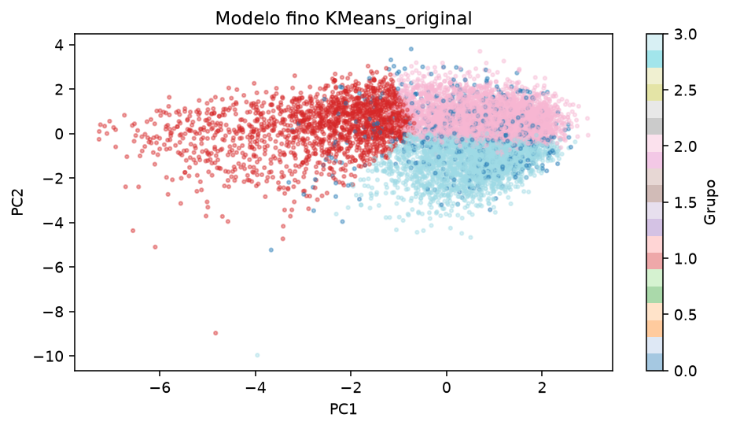

La proyección muestra PC1 y PC2; el clustering PCA utiliza todos los componentes retenidos. La separación visual no sustituye las métricas ni demuestra categorías musicales naturales.

| model | space | kind | mean | min | max |
| --- | --- | --- | --- | --- | --- |
| GMM | original | seed | 0.98218 | 0.96436 | 1.00000 |
| GMM | original | subsample | 0.97400 | 0.95676 | 0.99041 |
| GMM | pca | seed | 0.77305 | 0.55459 | 0.99514 |
| GMM | pca | subsample | 0.85683 | 0.80092 | 0.90663 |
| KMeans | original | seed | 0.99265 | 0.98967 | 0.99736 |
| KMeans | original | subsample | 0.92291 | 0.86672 | 0.98391 |
| KMeans | pca | seed | 0.98288 | 0.97183 | 0.99888 |
| KMeans | pca | subsample | 0.91711 | 0.86473 | 0.97560 |

PCA de la ampliación conserva 7 componentes y 90.81% de varianza. La preparación y PCA se ajustan solo con entrenamiento.

## 6. Interpretación final y límites

El perfil fino candidato presenta mayor concentración en esta evaluación adicional, con un intervalo de diferencia completamente positivo.

Un perfil más pequeño puede concentrar más canciones populares pero abarcar menos éxitos totales. La comparación informa concentración, cobertura, captura y separación; no se elige una historia mirando solo el mejor número. Si no mejora, el resultado se conserva.

Persisten límites: popularidad histórica de conveniencia; pocas canciones ≥70; falta de exposición, promoción, fecha e idioma; atributos agregados sin melodía o estructura; candidatos seleccionados tras observar entrenamiento; intervalos condicionales y contextos solapados. No se afirma que no exista ningún patrón posible si este diseño no lo confirma.

## 7. Referencia experimental y doce respuestas de la rúbrica

### Experimento de referencia conservado

### Método: Datos y preparación sin fuga

Fuente: Pandya, Spotify Tracks Dataset, Hugging Face. Licencia declarada en su ficha: bsd; no se atribuye una variante BSD no especificada. Se utilizan datos tabulares y no se distribuye audio. La popularidad es la registrada en el archivo, no reproducciones actuales.

| variable | unidad | faltantes_fuente | faltantes_train |
| --- | --- | --- | --- |
| danceability | 0–1 | 0 | 0 |
| energy | 0–1 | 0 | 0 |
| loudness | dB | 0 | 0 |
| speechiness | 0–1 | 0 | 0 |
| acousticness | 0–1 | 0 | 0 |
| instrumentalness | 0–1 | 0 | 0 |
| liveness | 0–1 | 0 | 0 |
| valence | 0–1 | 0 | 0 |
| tempo | BPM | 0 | 21 |
| duration_ms | ms | 0 | 0 |

| etapa | n |
| --- | --- |
| raw_rows | 114000 |
| unique_rows | 89741 |
| development | 8000 |
| inner_fit | 6162 |
| validation | 1838 |
| eligible_holdout | 25888 |
| holdout | 2000 |

Se conserva la primera aparición por ID sin seleccionar por popularidad. Variables fuera de rango, valores no finitos y tempo/duración no positivos pasan a faltantes. Medianas y transformaciones se ajustan solo con el subconjunto de ajuste, y se reajustan en desarrollo completo una vez congeladas las elecciones.

Los grupos de artistas unen colaboraciones transitivamente; dividir solo por cadena completa de artista dejaría fugas. En la prueba adicional se excluyen IDs previos, artistas individuales de toda la muestra anterior y vectores acústicos iguales tras redondeo a siete decimales. Esto no identifica todas las versiones semánticamente duplicadas ni constituye una muestra temporal o un dataset externo.

| variable | count | mean | std | min | 25% | 50% | 75% | max |
| --- | --- | --- | --- | --- | --- | --- | --- | --- |
| danceability | 8000.00000 | 0.56437 | 0.17655 | 0.00000 | 0.45400 | 0.57850 | 0.69400 | 0.98000 |
| energy | 8000.00000 | 0.63441 | 0.25514 | 0.00002 | 0.45700 | 0.67500 | 0.85200 | 1.00000 |
| loudness | 8000.00000 | -8.49959 | 5.11298 | -40.60600 | -10.40800 | -7.17650 | -5.12575 | 0.68100 |
| speechiness | 8000.00000 | 0.08823 | 0.11500 | 0.00000 | 0.03590 | 0.04880 | 0.08550 | 0.95900 |
| acousticness | 8000.00000 | 0.32615 | 0.33569 | 0.00000 | 0.01767 | 0.18900 | 0.61725 | 0.99600 |
| instrumentalness | 8000.00000 | 0.17058 | 0.32177 | 0.00000 | 0.00000 | 0.00006 | 0.08968 | 1.00000 |
| liveness | 8000.00000 | 0.21466 | 0.19279 | 0.00986 | 0.09810 | 0.13100 | 0.27200 | 0.99100 |
| valence | 8000.00000 | 0.47440 | 0.26130 | 0.00000 | 0.26100 | 0.46500 | 0.68700 | 0.99100 |
| tempo | 7979.00000 | 122.11500 | 29.61063 | 35.79000 | 99.35450 | 122.08100 | 140.05800 | 219.97100 |
| duration_ms | 8000.00000 | 227864.00300 | 100381.80579 | 13386.00000 | 172054.75000 | 212631.00000 | 262989.50000 | 2646866.00000 |

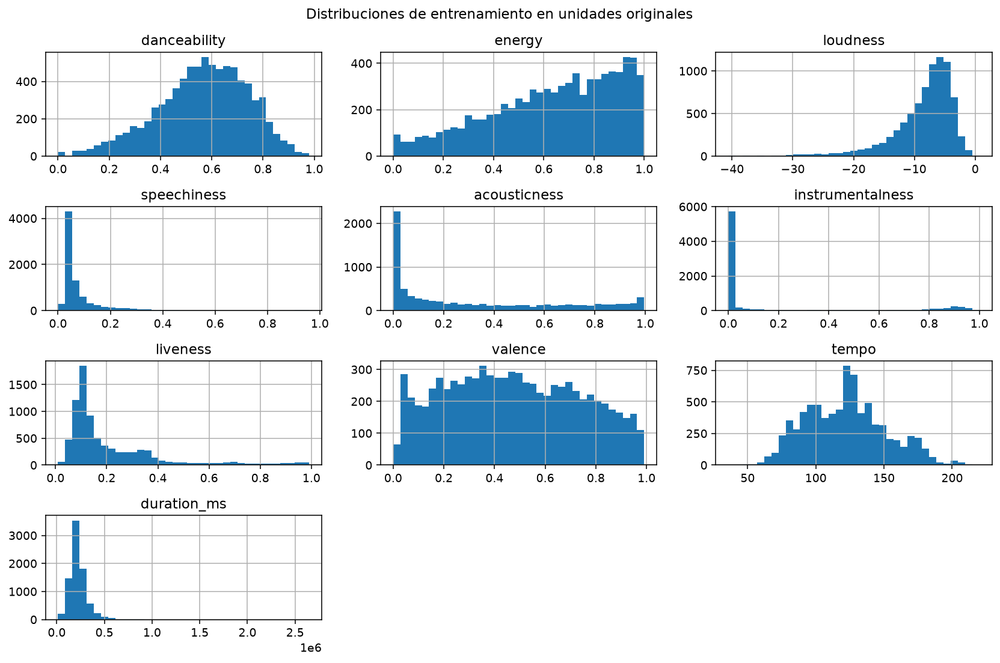

| variable | skew_raw | skew_selected | iqr_outlier_fraction |
| --- | --- | --- | --- |
| danceability | -0.43405 | -0.43405 | 0.00762 |
| energy | -0.55321 | -0.55321 | 0.00000 |
| loudness | -1.91674 | -1.91674 | 0.05187 |
| speechiness | 4.44129 | 4.44129 | 0.12200 |
| acousticness | 0.66815 | 0.66815 | 0.00000 |
| instrumentalness | 1.59588 | 1.59588 | 0.21838 |
| liveness | 2.09403 | 2.09403 | 0.07925 |
| valence | 0.09873 | 0.09873 | 0.00000 |
| tempo | 0.28609 | 0.28648 | 0.00525 |
| duration_ms | 4.70301 | 4.70301 | 0.04600 |

Los extremos IQR se describen, no se eliminan automáticamente: instrumentalidad o habla elevadas pueden ser legítimas. Yeo-Johnson transforma las distribuciones marginales y después estandariza; no garantiza gaussianidad conjunta ni mejores agrupamientos. StandardScaler iguala escalas, pero no elimina asimetría.

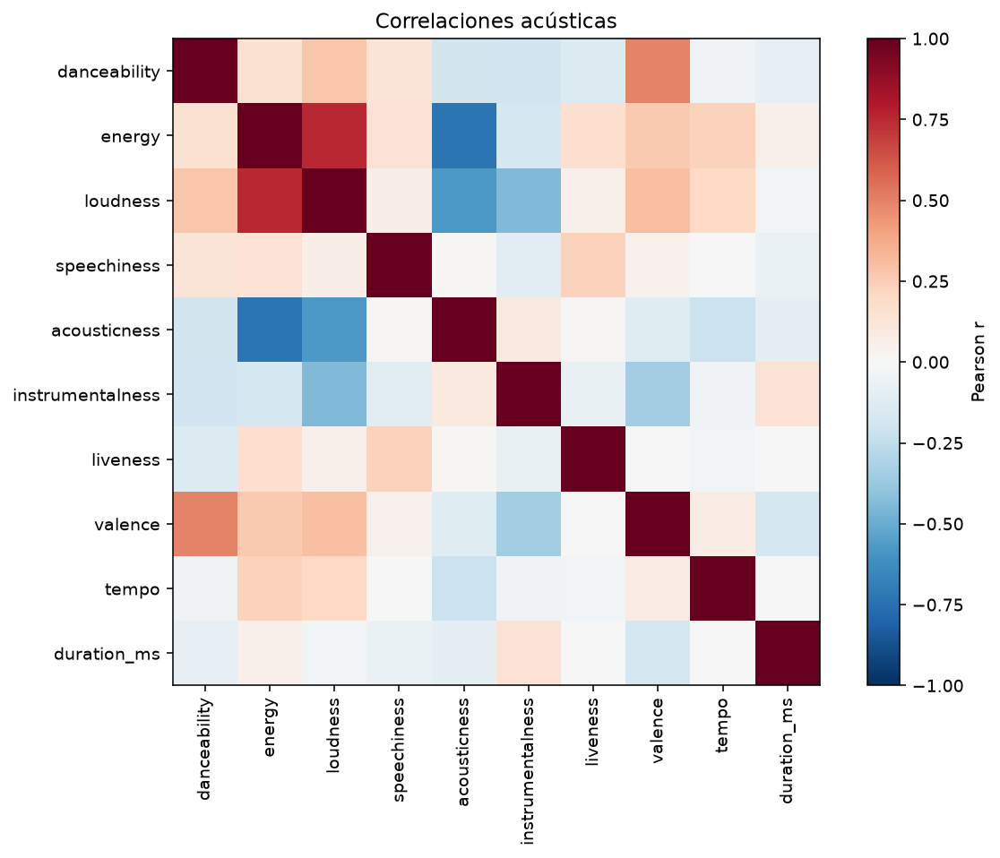

energy/loudness: r=+0.753; energy/acousticness: r=-0.727; loudness/acousticness: r=-0.572. Las correlaciones anticipan redundancia parcial, no autorizan a descartar información sin comparar.

### Método: Protocolo y selección

El protocolo se escribió antes de ejecutar la nueva búsqueda y se conserva con huella SHA-256. Esta revisión es exploratoria y está informada por la versión anterior; no se presenta como prerregistro externo. No se usa la prueba adicional para seleccionar. El test anterior ya observado tampoco selecciona.

| preparacion | silhouette_validacion_media |
| --- | --- |
| standard | 0.19514 |
| yeo_johnson | 0.19669 |

Regla común: maximizar Silhouette en validación, calculado siempre en las diez variables estandarizadas por el escalador de referencia. Se exige al menos 2 % por grupo en ajuste y validación. Dentro de 0,005 del máximo se prefiere menor K; a igualdad de K, menor BIC para GMM. Para cambiar de preparación se exige ganancia media superior a 0,005 en las cuatro configuraciones. Es una regla explícita de parsimonia, no una prueba de significación.

BIC y AIC se calculan como diagnósticos de densidad, pero no se priorizan sobre la utilidad de segmentación. Este cambio de objetivo respecto a la versión anterior se declara; no prueba que la densidad GMM ahora esté mejor ajustada. BIC no se compara entre espacios o transformaciones diferentes. La geometría común favorece por definición conservar la representación estandarizada original.

| preprocessing | model | space | k | covariance | val_sil_common | bic | min_train_fraction | min_val_fraction |
| --- | --- | --- | --- | --- | --- | --- | --- | --- |
| standard | KMeans | original | 2 | — | 0.23418 | — | 0.24862 | 0.25408 |
| standard | GMM | original | 2 | full | 0.13091 | 114685.78702 | 0.35232 | 0.31937 |
| standard | KMeans | pca | 2 | — | 0.23521 | — | 0.24684 | 0.25245 |
| standard | GMM | pca | 2 | diag | 0.18028 | 125994.22377 | 0.35638 | 0.37486 |
| yeo_johnson | KMeans | original | 2 | — | 0.18759 | — | 0.34826 | 0.37758 |
| yeo_johnson | GMM | original | 2 | diag | 0.21773 | 164936.33045 | 0.23710 | 0.25082 |
| yeo_johnson | KMeans | pca | 2 | — | 0.18540 | — | 0.35378 | 0.38139 |
| yeo_johnson | GMM | pca | 2 | diag | 0.19605 | 128173.57834 | 0.32652 | 0.35201 |

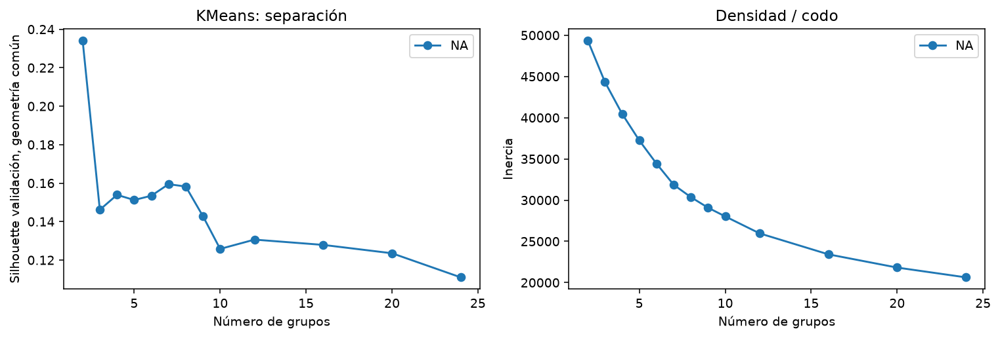

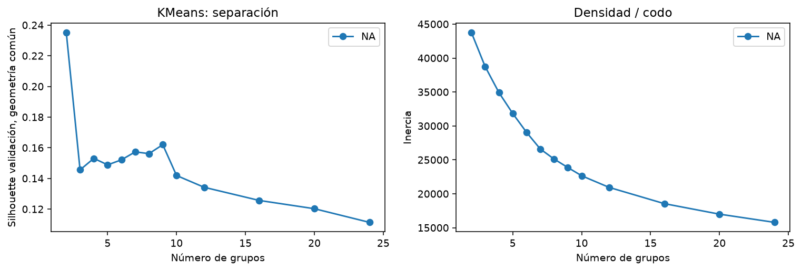

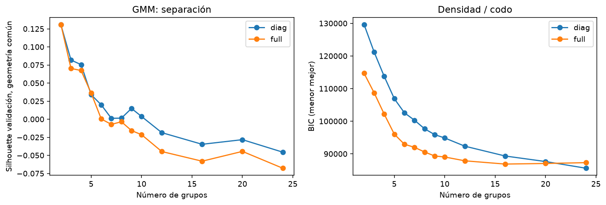

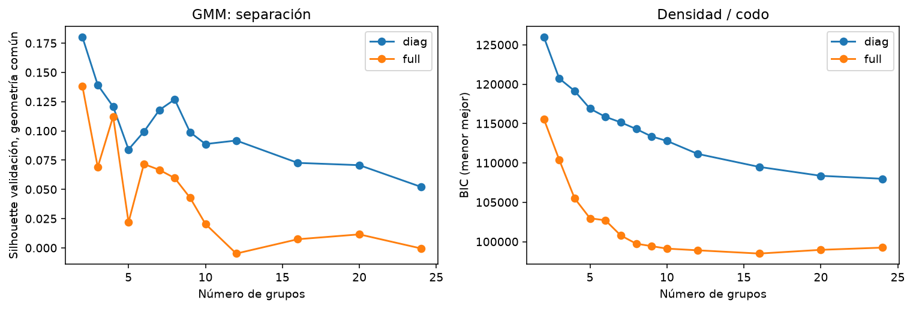

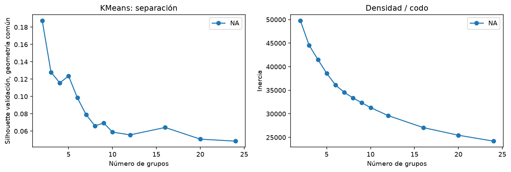

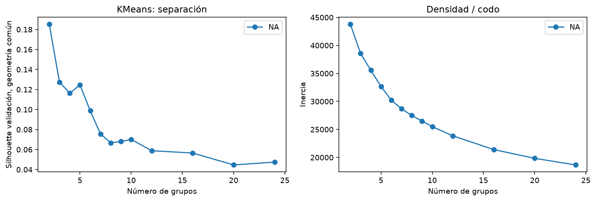

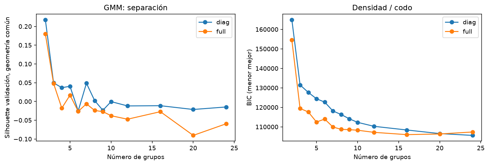

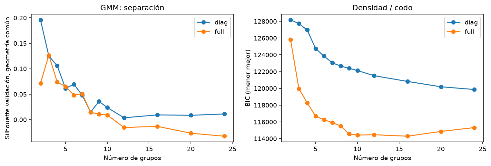

### Método: PCA e interpretación

Umbral fijado en 90 %: se retienen 7 componentes y 90.81%. PC1+PC2 muestran solo 44.10%; no son todo el espacio del modelo.

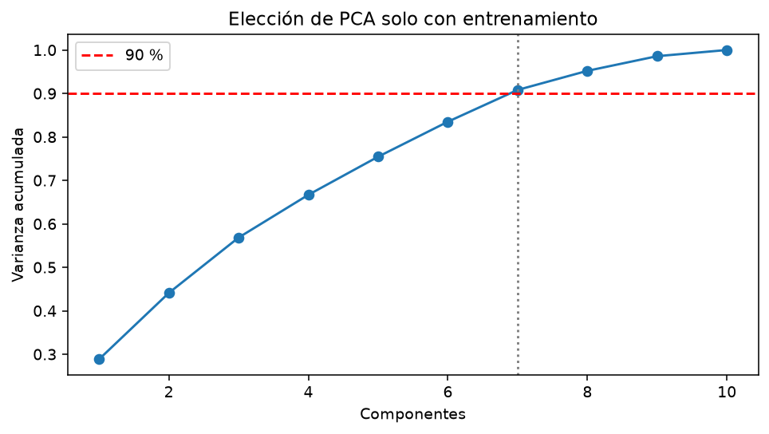

| variable | PC1 | PC2 |
| --- | --- | --- |
| danceability | 0.27306 | 0.43502 |
| energy | 0.49766 | -0.29156 |
| loudness | 0.51210 | -0.09364 |
| speechiness | 0.10563 | 0.14135 |
| acousticness | -0.42762 | 0.35939 |
| instrumentalness | -0.28995 | -0.33153 |
| liveness | 0.05869 | -0.08664 |
| valence | 0.31904 | 0.46178 |
| tempo | 0.17471 | -0.24383 |
| duration_ms | -0.04090 | -0.42157 |

PC1: loudness (+0.512), energy (+0.498), acousticness (-0.428), valence (+0.319). El componente contrasta los atributos positivos y negativos indicados. Si se selecciona Yeo-Johnson, las cargas corresponden a características transformadas, no a relaciones lineales con las unidades físicas originales. El signo global es arbitrario.

PC2: valence (+0.462), danceability (+0.435), duration_ms (-0.422), acousticness (+0.359). El componente contrasta los atributos positivos y negativos indicados. Si se selecciona Yeo-Johnson, las cargas corresponden a características transformadas, no a relaciones lineales con las unidades físicas originales. El signo global es arbitrario.

PC1 contrapone intensidad y nivel sonoro (energy y loudness) frente a carácter acústico (acousticness). En términos musicales, resume un eje de sonido más intenso/producido frente a textura más acústica; no clasifica automáticamente géneros ni calidad.

PC2 contrapone valencia y bailabilidad frente a instrumentalidad y duración. Describe un eje de positividad sonora y ritmo bailable frente a formatos más largos o instrumentales. Son interpretaciones descriptivas de las cargas observadas, no emociones del oyente ni una receta de éxito.

### Método: Tabla comparativa obligatoria y comparación justa

Original significa diez características preparadas, sin PCA. Native usa la geometría de cada ajuste; reference_original siempre utiliza las diez características con StandardScaler de referencia. Solo estas últimas filas permiten comparar separaciones en la misma geometría. Se incluyen entrenamiento y prueba, hiperparámetros, grupos, tres métricas, tiempos y ARI. Ruido=0 porque ambos asignan todas las canciones; no equivale a detectar ausencia de anomalías.

| model | space | preprocessing | split | evaluation_space | hyperparameters | groups | noise_pct | fit_seconds | predict_seconds | ari_vs_original | silhouette | davies_bouldin | calinski_harabasz |
| --- | --- | --- | --- | --- | --- | --- | --- | --- | --- | --- | --- | --- | --- |
| KMeans | original | standard | train | native | {"k": 2, "covariance": "NA"} | 2 | 0.00000 | 0.13203 | 0.00056 | — | 0.24933 | 1.68308 | 1947.65054 |
| KMeans | original | standard | train | reference_original | {"k": 2, "covariance": "NA"} | 2 | 0.00000 | 0.13203 | 0.00056 | — | 0.24933 | 1.68308 | 1947.65054 |
| KMeans | original | standard | test | native | {"k": 2, "covariance": "NA"} | 2 | 0.00000 | 0.13203 | 0.00056 | — | 0.21839 | 1.76828 | 389.78056 |
| KMeans | original | standard | test | reference_original | {"k": 2, "covariance": "NA"} | 2 | 0.00000 | 0.13203 | 0.00056 | — | 0.21839 | 1.76828 | 389.78056 |
| GMM | original | standard | train | native | {"k": 2, "covariance": "full"} | 2 | 0.00000 | 0.50247 | 0.00117 | — | 0.12461 | 3.03457 | 735.53684 |
| GMM | original | standard | train | reference_original | {"k": 2, "covariance": "full"} | 2 | 0.00000 | 0.50247 | 0.00117 | — | 0.12461 | 3.03457 | 735.53684 |
| GMM | original | standard | test | native | {"k": 2, "covariance": "full"} | 2 | 0.00000 | 0.50247 | 0.00117 | — | 0.11776 | 3.15014 | 159.57386 |
| GMM | original | standard | test | reference_original | {"k": 2, "covariance": "full"} | 2 | 0.00000 | 0.50247 | 0.00117 | — | 0.11776 | 3.15014 | 159.57386 |
| KMeans | pca | standard | train | native | {"k": 2, "covariance": "NA"} | 2 | 0.00000 | 0.12457 | 0.00052 | 0.98252 | 0.27031 | 1.55983 | 2194.56123 |
| KMeans | pca | standard | train | reference_original | {"k": 2, "covariance": "NA"} | 2 | 0.00000 | 0.12457 | 0.00052 | 0.98252 | 0.24967 | 1.67786 | 1947.30985 |
| KMeans | pca | standard | test | native | {"k": 2, "covariance": "NA"} | 2 | 0.00000 | 0.12457 | 0.00052 | 0.98304 | 0.23908 | 1.63408 | 436.47928 |
| KMeans | pca | standard | test | reference_original | {"k": 2, "covariance": "NA"} | 2 | 0.00000 | 0.12457 | 0.00052 | 0.98304 | 0.22025 | 1.76713 | 389.69274 |
| GMM | pca | standard | train | native | {"k": 2, "covariance": "diag"} | 2 | 0.00000 | 0.52224 | 0.00053 | 0.11836 | 0.19174 | 3.36682 | 569.54647 |
| GMM | pca | standard | train | reference_original | {"k": 2, "covariance": "diag"} | 2 | 0.00000 | 0.52224 | 0.00053 | 0.11836 | 0.17610 | 3.55760 | 515.90654 |
| GMM | pca | standard | test | native | {"k": 2, "covariance": "diag"} | 2 | 0.00000 | 0.52224 | 0.00053 | 0.10868 | 0.19040 | 3.24735 | 144.15876 |
| GMM | pca | standard | test | reference_original | {"k": 2, "covariance": "diag"} | 2 | 0.00000 | 0.52224 | 0.00053 | 0.10868 | 0.17461 | 3.44347 | 130.81221 |

Silhouette: mayor mejor, cohesión frente a separación. Davies-Bouldin: menor mejor, similitud entre grupos. Calinski-Harabasz: mayor mejor, dispersión entre grupos respecto a dispersión interna. Favorecen agrupamientos compactos y no son medidas de gusto o éxito. Silhouette usa hasta 2.000 observaciones con semilla fija; las otras métricas usan el conjunto completo.

### Método: Estabilidad y costo

| model | space | kind | mean | min | max |
| --- | --- | --- | --- | --- | --- |
| GMM | original | seed | 1.00000 | 1.00000 | 1.00000 |
| GMM | original | subsample | 0.99197 | 0.98797 | 0.99598 |
| GMM | pca | seed | 1.00000 | 1.00000 | 1.00000 |
| GMM | pca | subsample | 0.94811 | 0.93066 | 0.95669 |
| KMeans | original | seed | 0.99433 | 0.98938 | 1.00000 |
| KMeans | original | subsample | 0.98795 | 0.98301 | 0.99360 |
| KMeans | pca | seed | 0.99681 | 0.99362 | 1.00000 |
| KMeans | pca | subsample | 0.98971 | 0.98298 | 0.99787 |

Cuatro semillas y cuatro submuestras de 80 % por configuración; ARI entre pares sobre las mismas canciones de prueba. Transformación y PCA permanecen fijos: mide estabilidad condicional de los modelos. No se selecciona con esta prueba. La incertidumbre de toda la preparación requiere remuestrear el pipeline completo.

| model | space | fit_seconds_median | fit_seconds_min | fit_seconds_max | predict_seconds_median | predict_seconds_min | predict_seconds_max |
| --- | --- | --- | --- | --- | --- | --- | --- |
| GMM | original | 0.79359 | 0.58805 | 0.90425 | 0.00209 | 0.00150 | 0.00228 |
| GMM | pca | 0.79011 | 0.48696 | 0.89467 | 0.00338 | 0.00065 | 0.00485 |
| KMeans | original | 0.11793 | 0.11669 | 0.12391 | 0.00051 | 0.00050 | 0.00052 |
| KMeans | pca | 0.30821 | 0.24680 | 0.45715 | 0.00074 | 0.00052 | 0.00313 |

Preparación final compartida (incluye representación de referencia y PCA): 0.0642 s. Los tiempos repetidos de modelos excluyen búsqueda y preparación, usan un hilo numérico y no son una garantía de rendimiento en otro equipo.

### Método: Interpretación y acciones por perfil

### KMeans_original

| cluster | n | danceability | energy | loudness | speechiness | acousticness | instrumentalness | liveness | valence | tempo | duration_ms |
| --- | --- | --- | --- | --- | --- | --- | --- | --- | --- | --- | --- |
| 0 | 5967 | 0.61000 | 0.76300 | -6.13400 | 0.05470 | 0.07840 | 0.00002 | 0.14100 | 0.53300 | 125.00100 | 214813.00000 |
| 1 | 2033 | 0.47100 | 0.30300 | -12.94000 | 0.03930 | 0.81700 | 0.00504 | 0.11700 | 0.26200 | 108.86950 | 201293.00000 |

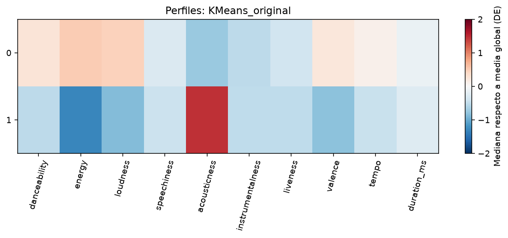

Grupo 0: intenso, mixto, 125.0 BPM, 3.58 min; 5967 canciones. Acción: filtrar referencias con esta combinación y contrastarlas por escucha. No prescribe una mezcla, género verdadero o público objetivo.

Grupo 1: suave, acústico, 108.9 BPM, 3.35 min; 2033 canciones. Acción: filtrar referencias con esta combinación y contrastarlas por escucha. No prescribe una mezcla, género verdadero o público objetivo.

### GMM_original

| cluster | n | danceability | energy | loudness | speechiness | acousticness | instrumentalness | liveness | valence | tempo | duration_ms |
| --- | --- | --- | --- | --- | --- | --- | --- | --- | --- | --- | --- |
| 0 | 2755 | 0.54300 | 0.66000 | -9.09800 | 0.04820 | 0.09650 | 0.55900 | 0.12200 | 0.31500 | 122.02600 | 227000.00000 |
| 1 | 5245 | 0.58900 | 0.67900 | -6.58800 | 0.04930 | 0.21700 | 0.00000 | 0.13700 | 0.52500 | 122.15250 | 207832.00000 |

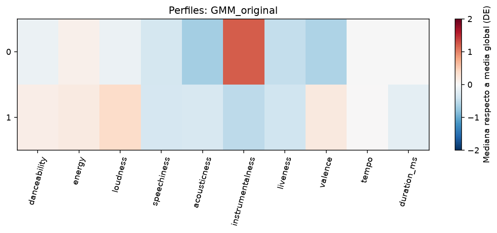

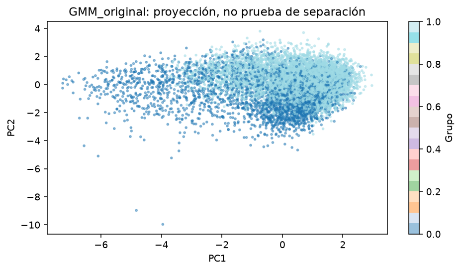

Grupo 0: intenso, instrumental, 122.0 BPM, 3.78 min; 2755 canciones. Acción: filtrar referencias con esta combinación y contrastarlas por escucha. No prescribe una mezcla, género verdadero o público objetivo.

Grupo 1: intenso, mixto, 122.2 BPM, 3.46 min; 5245 canciones. Acción: filtrar referencias con esta combinación y contrastarlas por escucha. No prescribe una mezcla, género verdadero o público objetivo.

### KMeans_pca

| cluster | n | danceability | energy | loudness | speechiness | acousticness | instrumentalness | liveness | valence | tempo | duration_ms |
| --- | --- | --- | --- | --- | --- | --- | --- | --- | --- | --- | --- |
| 0 | 5990 | 0.61000 | 0.76200 | -6.14200 | 0.05460 | 0.07930 | 0.00002 | 0.14100 | 0.53250 | 125.00000 | 214889.00000 |
| 1 | 2010 | 0.46800 | 0.29900 | -13.01800 | 0.03930 | 0.81850 | 0.00516 | 0.11700 | 0.26100 | 108.40100 | 200413.00000 |

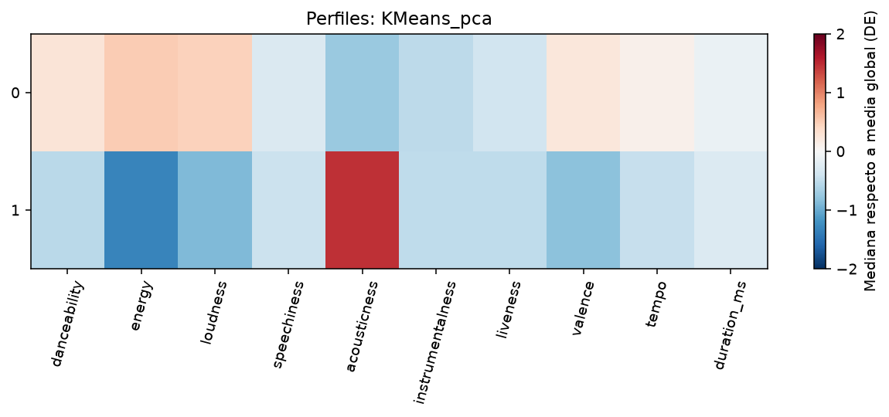

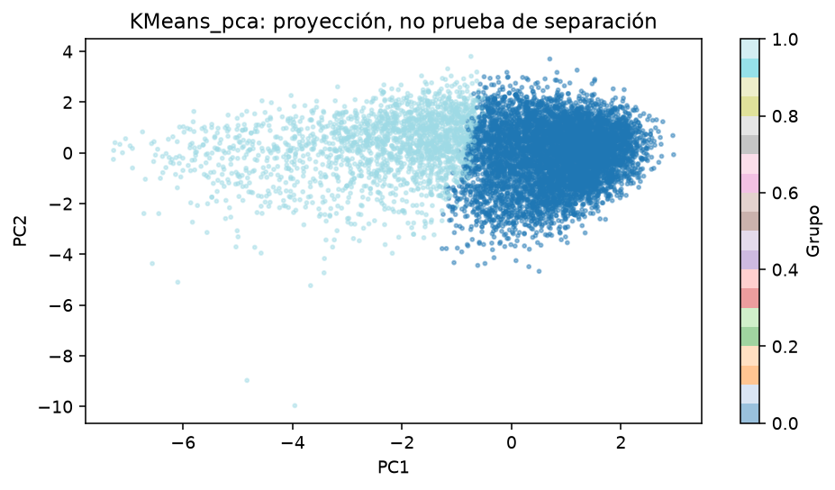

Grupo 0: intenso, mixto, 125.0 BPM, 3.58 min; 5990 canciones. Acción: filtrar referencias con esta combinación y contrastarlas por escucha. No prescribe una mezcla, género verdadero o público objetivo.

Grupo 1: suave, acústico, 108.4 BPM, 3.34 min; 2010 canciones. Acción: filtrar referencias con esta combinación y contrastarlas por escucha. No prescribe una mezcla, género verdadero o público objetivo.

### GMM_pca

| cluster | n | danceability | energy | loudness | speechiness | acousticness | instrumentalness | liveness | valence | tempo | duration_ms |
| --- | --- | --- | --- | --- | --- | --- | --- | --- | --- | --- | --- |
| 0 | 2197 | 0.55700 | 0.74400 | -7.56900 | 0.07320 | 0.10600 | 0.02200 | 0.28100 | 0.38500 | 125.50250 | 224017.00000 |
| 1 | 5803 | 0.58400 | 0.64900 | -7.03500 | 0.04450 | 0.21900 | 0.00002 | 0.12000 | 0.48900 | 120.22800 | 209910.00000 |

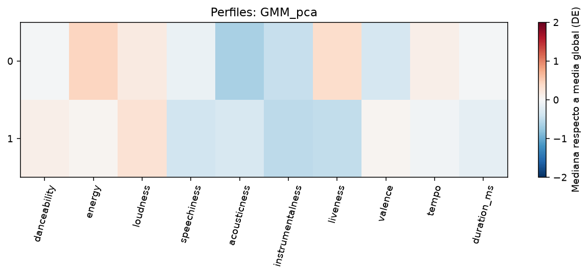

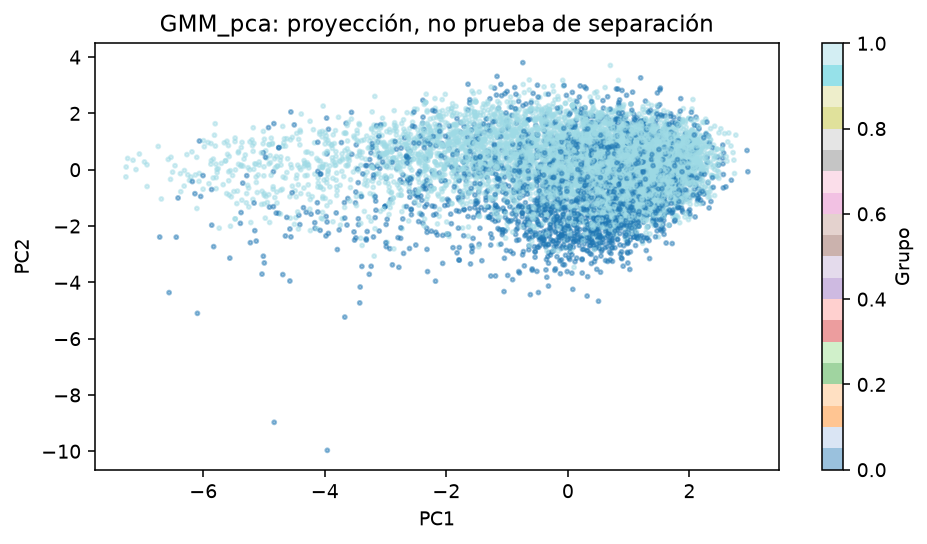

Grupo 0: intenso, mixto, 125.5 BPM, 3.73 min; 2197 canciones. Acción: filtrar referencias con esta combinación y contrastarlas por escucha. No prescribe una mezcla, género verdadero o público objetivo.

Grupo 1: intermedio, mixto, 120.2 BPM, 3.50 min; 5803 canciones. Acción: filtrar referencias con esta combinación y contrastarlas por escucha. No prescribe una mezcla, género verdadero o público objetivo.

### Distribuciones de popularidad después del agrupamiento

| model | space | split | cluster | n | median | q25 | q75 |
| --- | --- | --- | --- | --- | --- | --- | --- |
| KMeans | original | test | 0 | 1493 | 34.00000 | 21.00000 | 47.00000 |
| KMeans | original | test | 1 | 507 | 39.00000 | 22.00000 | 52.00000 |
| KMeans | original | train | 0 | 5967 | 34.00000 | 20.00000 | 48.00000 |
| KMeans | original | train | 1 | 2033 | 29.00000 | 17.00000 | 46.00000 |
| GMM | original | test | 0 | 731 | 30.00000 | 19.00000 | 49.00000 |
| GMM | original | test | 1 | 1269 | 37.00000 | 23.00000 | 49.00000 |
| GMM | original | train | 0 | 2755 | 26.00000 | 16.00000 | 45.00000 |
| GMM | original | train | 1 | 5245 | 36.00000 | 22.00000 | 49.00000 |
| KMeans | pca | test | 0 | 1497 | 34.00000 | 21.00000 | 47.00000 |
| KMeans | pca | test | 1 | 503 | 39.00000 | 22.00000 | 52.00000 |
| KMeans | pca | train | 0 | 5990 | 34.00000 | 20.00000 | 48.00000 |
| KMeans | pca | train | 1 | 2010 | 29.00000 | 17.00000 | 46.00000 |
| GMM | pca | test | 0 | 567 | 28.00000 | 19.00000 | 43.00000 |
| GMM | pca | test | 1 | 1433 | 37.00000 | 23.00000 | 51.00000 |
| GMM | pca | train | 0 | 2197 | 27.00000 | 17.00000 | 43.00000 |
| GMM | pca | train | 1 | 5803 | 35.00000 | 20.00000 | 50.00000 |

Las medianas y cuartiles describen el archivo. Las diferencias no garantizan éxito individual ni prueban causalidad. La validación por artistas cambia la población: no se comparan sin más estas cifras con las del test anterior.

## 8. Las doce respuestas de la rúbrica

### 1. Escalado

| model | ari_scaled_unscaled | silhouette_scaled_common | silhouette_unscaled_labels_common |
| --- | --- | --- | --- |
| KMeans | 0.00238 | 0.24933 | 0.13187 |
| GMM | 0.59787 | 0.12461 | 0.12786 |

Duración en milisegundos domina distancias sin escalar frente a variables 0–1. El control conserva hiperparámetros y evalúa sus etiquetas en la misma geometría común. El ARI cuantifica el cambio de partición y evita concluir por un Silhouette medido con otra escala.

### 2. Elección de hiperparámetros

| model | space | k | covariance | val_sil_common | bic |
| --- | --- | --- | --- | --- | --- |
| KMeans | original | 2 | NA | 0.23418 | — |
| GMM | original | 2 | full | 0.13091 | 114685.78702 |
| KMeans | pca | 2 | NA | 0.23521 | — |
| GMM | pca | 2 | diag | 0.18028 | 125994.22377 |

La búsqueda y sus curvas abarcan K=2–10,12,16,20,24 y covarianzas full/diag para GMM. Se prioriza separación de validación con tamaños mínimos y parsimonia; BIC explica ajuste de densidad, distinto del objetivo de segmentación. La tabla completa conserva todos los intentos, no solo ganadores.

### 3. Sesgo de las métricas

| model | space | silhouette | davies_bouldin | calinski_harabasz |
| --- | --- | --- | --- | --- |
| KMeans | original | 0.21839 | 1.76828 | 389.78056 |
| GMM | original | 0.11776 | 3.15014 | 159.57386 |
| KMeans | pca | 0.22025 | 1.76713 | 389.69274 |
| GMM | pca | 0.17461 | 3.44347 | 130.81221 |

El objetivo euclidiano y el criterio favorecen a K-Means y a gaussianas compactas. Las nubes superpuestas en los mapas advierten que los perfiles pueden ser discretizaciones de un continuo. La proyección PC1/PC2 no prueba separación en todas las dimensiones; contrastar con estas métricas y no solo colores.

### 4. Ruido y atípicos

| variable | skew_raw | skew_selected | iqr_outlier_fraction |
| --- | --- | --- | --- |
| danceability | -0.43405 | -0.43405 | 0.00762 |
| energy | -0.55321 | -0.55321 | 0.00000 |
| loudness | -1.91674 | -1.91674 | 0.05187 |
| speechiness | 4.44129 | 4.44129 | 0.12200 |
| acousticness | 0.66815 | 0.66815 | 0.00000 |
| instrumentalness | 1.59588 | 1.59588 | 0.21838 |
| liveness | 2.09403 | 2.09403 | 0.07925 |
| valence | 0.09873 | 0.09873 | 0.00000 |
| tempo | 0.28609 | 0.28648 | 0.00525 |
| duration_ms | 4.70301 | 4.70301 | 0.04600 |

No se utilizó DBSCAN. K-Means y GMM asignan todos los puntos: ruido 0 % es una propiedad del método. Los atípicos pueden desplazar centroides y covarianzas. No se eliminan perfiles musicales válidos por IQR; se compara una transformación marginal predefinida y se describen sus límites.

### 5. Componentes principales

7 componentes, varianza 90.81%; dos primeras dimensiones 44.10%.

| variable | PC1 | PC2 |
| --- | --- | --- |
| danceability | 0.27306 | 0.43502 |
| energy | 0.49766 | -0.29156 |
| loudness | 0.51210 | -0.09364 |
| speechiness | 0.10563 | 0.14135 |
| acousticness | -0.42762 | 0.35939 |
| instrumentalness | -0.28995 | -0.33153 |
| liveness | 0.05869 | -0.08664 |
| valence | 0.31904 | 0.46178 |
| tempo | 0.17471 | -0.24383 |
| duration_ms | -0.04090 | -0.42157 |

Las mayores cargas absolutas de la sección 4 definen los contrastes acústicos; se interpretan con sus signos. La varianza retenida no es porcentaje de información musical ni de éxito explicado.

### 6. Efecto de la reducción

KMeans, prueba en geometría común: Silhouette 0.2184 → 0.2203; Davies-Bouldin 1.7683 → 1.7671; Calinski-Harabasz 389.78 → 389.69. PCA puede quitar redundancia o descartar diferencias útiles; las cifras no identifican por sí solas cuál causa actuó. Diez variables no justifican invocar automáticamente maldición de dimensionalidad.

GMM, prueba en geometría común: Silhouette 0.1178 → 0.1746; Davies-Bouldin 3.1501 → 3.4435; Calinski-Harabasz 159.57 → 130.81. PCA puede quitar redundancia o descartar diferencias útiles; las cifras no identifican por sí solas cuál causa actuó. Diez variables no justifican invocar automáticamente maldición de dimensionalidad.

### 7. Comparación justa

| model | space | evaluation_space | silhouette | davies_bouldin | calinski_harabasz |
| --- | --- | --- | --- | --- | --- |
| KMeans | original | native | 0.24933 | 1.68308 | 1947.65054 |
| KMeans | original | reference_original | 0.24933 | 1.68308 | 1947.65054 |
| GMM | original | native | 0.12461 | 3.03457 | 735.53684 |
| GMM | original | reference_original | 0.12461 | 3.03457 | 735.53684 |
| KMeans | pca | native | 0.27031 | 1.55983 | 2194.56123 |
| KMeans | pca | reference_original | 0.24967 | 1.67786 | 1947.30985 |
| GMM | pca | native | 0.19174 | 3.36682 | 569.54647 |
| GMM | pca | reference_original | 0.17610 | 3.55760 | 515.90654 |

Comparar Native original con Native PCA mezcla geometrías. La conclusión de separación utiliza reference_original. Cuando las conclusiones difieren, se prioriza esta geometría declarada y se reconoce el sesgo a favor de preservarla.

### 8. Cambio de asignaciones

| model | split | ari_vs_original |
| --- | --- | --- |
| KMeans | train | 0.98252 |
| KMeans | test | 0.98304 |
| GMM | train | 0.11836 |
| GMM | test | 0.10868 |

ARI=1 implica particiones equivalentes aun con etiquetas permutadas; cercano a cero es acuerdo compatible con azar. Puede ser negativo. Se compara el mismo conjunto en cada fila y no popularidad o género.

### 9. Estabilidad

| model | space | kind | mean | min | max |
| --- | --- | --- | --- | --- | --- |
| GMM | original | seed | 1.00000 | 1.00000 | 1.00000 |
| GMM | original | subsample | 0.99197 | 0.98797 | 0.99598 |
| GMM | pca | seed | 1.00000 | 1.00000 | 1.00000 |
| GMM | pca | subsample | 0.94811 | 0.93066 | 0.95669 |
| KMeans | original | seed | 0.99433 | 0.98938 | 1.00000 |
| KMeans | original | subsample | 0.98795 | 0.98301 | 0.99360 |
| KMeans | pca | seed | 0.99681 | 0.99362 | 1.00000 |
| KMeans | pca | subsample | 0.98971 | 0.98298 | 0.99787 |

En original, mayor ARI medio condicional: GMM=0.9960; KMeans=0.9911. K-Means puede variar por centroides iniciales; GMM añade sensibilidad de covarianzas y máximos locales. Un ARI alto no prueba que los grupos sean verdaderos.

En pca, mayor ARI medio condicional: KMeans=0.9933; GMM=0.9741. K-Means puede variar por centroides iniciales; GMM añade sensibilidad de covarianzas y máximos locales. Un ARI alto no prueba que los grupos sean verdaderos.

### 10. Costo computacional

| model | space | fit_seconds_median | fit_seconds_min | fit_seconds_max | predict_seconds_median | predict_seconds_min | predict_seconds_max |
| --- | --- | --- | --- | --- | --- | --- | --- |
| GMM | original | 0.79359 | 0.58805 | 0.90425 | 0.00209 | 0.00150 | 0.00228 |
| GMM | pca | 0.79011 | 0.48696 | 0.89467 | 0.00338 | 0.00065 | 0.00485 |
| KMeans | original | 0.11793 | 0.11669 | 0.12391 | 0.00051 | 0.00050 | 0.00052 |
| KMeans | pca | 0.30821 | 0.24680 | 0.45715 | 0.00074 | 0.00052 | 0.00313 |

Con 100 veces más observaciones no se extrapolan segundos ciegamente. K-Means escala aproximadamente O(n·K·d·iteraciones); GMM full añade operaciones de covarianza O(n·K·d²) y factorización O(K·d³) por iteración. Reducir d puede ayudar a GMM, pero depende también de convergencia. Silhouette completo tiene costo cuadrático en n; mantener muestreo. Incluir ajuste/transformación PCA antes de afirmar ahorro total.

### 11. Visualización no lineal

No se ejecutó UMAP ni t-SNE: son opcionales. PCA muestra 44.10% en dos ejes y no todo el espacio. Islas en una visualización no lineal hipotética no demostrarían grupos naturales. t-SNE altera distancias globales y densidades, depende de parámetros y no es entrada de este clustering.

### 12. Recomendación final

La ampliación se interpreta con las secciones 2–6 anteriores. La recomendación y cifras de referencia siguientes corresponden al experimento anterior de 2.000 canciones, no a la nueva evaluación de la ampliación. Ninguna configuración se elige mirando popularidad de prueba.

Para la pregunta de popularidad, el contraste principal de KMeans_pca da lift 1.01 e IC95 de diferencia [-1.46, +1.76] pp. No se confirma una mayor concentración en la nueva evaluación: el intervalo de la diferencia incluye cero. No se recomienda convertir el perfil en regla comercial ni escoger otra configuración porque produzca una asociación más favorable. La recomendación geométrica que sigue se refiere a la calidad de agrupamiento, no a predicción de éxito.

Se recomienda provisionalmente KMeans_pca, elegido en validación con Silhouette común=0.2352; no se cambia por los resultados de prueba ni popularidad. Revisar conjuntamente las tres métricas, estabilidad, tamaños y perfiles, y reconocer que diferencias pequeñas no demuestran superioridad estadística.

Limitaciones: muestra histórica de conveniencia; exclusión por artistas modifica la población y no equivale a evaluación temporal; versiones no detectadas; características agregadas omiten melodía, letra y secciones; sin evaluación de oyentes. Con más tiempo: validación temporal/externa, remuestreo de toda la preparación, protocolo humano y medidas longitudinales de exposición/promoción.

## 9. Reproducción y presentación

Ejecutar Proyecto_Mejorado.ipynb o python mejorar_proyecto.py para todas las etapas. Para recalcular esta ampliación desde resultados previos: python analizar_contextos.py. Protocolo, selección congelada, IDs, tablas y figuras están incluidos. El cierre auditivo es ilustrativo y requiere escuchar legalmente los enlaces, sin prometer un fragmento o estructura ganadora.

Se utilizó ChatGPT/Codex para implementación y documentación. Completar autores y revisar personalmente antes de defender. Fuente: Pandya, M. (s. f.). Spotify Tracks Dataset [Conjunto de datos]. Hugging Face. https://huggingface.co/datasets/maharshipandya/spotify-tracks-dataset

Pedregosa, F., et al. (2011). Scikit-learn: Machine learning in Python. Journal of Machine Learning Research, 12, 2825–2830. https://jmlr.org/papers/v12/pedregosa11a.html